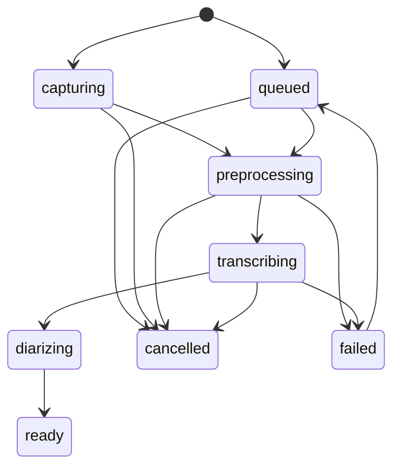

# Đặc tả kiến trúc

**Dự án:** Hệ thống trợ lý chuyển đổi, tóm tắt và trích xuất biên bản cuộc họp / bài giảng tiếng Việt  
**Phiên bản:** 1.4  
**Ngày:** 2026-10-28  
**Phạm vi:** Phương thức 1 và Phương thức 2, ở mức triển khai được

Hợp đồng trường và đường dẫn nằm ở [API và dữ liệu](API_AND_DATA.md). Thư viện và Docker nằm ở [công nghệ và môi trường](TECH_STACK_AND_ENVIRONMENT.md). Sơ đồ tuần tự từng luồng, key Redis, và hiện trạng code nằm ở [phân tích luồng](FLOWS.md).

## 1. Hình dạng hệ thống

Trình duyệt nói chuyện với Caddy, rồi tới Next.js hoặc FastAPI. FastAPI ghi Postgres, đẩy việc nặng vào Redis, và trả lời ngay. Chỉ `worker-gpu` nạp Whisper hoặc pyannote. `worker-io` chỉ gọi LLM.

```text
Trình duyệt
    │  cùng origin qua Caddy: REST, SSE, WebSocket PCM
    ▼
FastAPI  ───────────────► Postgres
    │                         ▲
    │ enqueue gpu hoặc io     │ đọc / ghi job, chữ, sự kiện
    ▼                         │
Redis ◄──── pub/sub ─────────┤
    ▲
    ├─ worker-gpu: FFmpeg, VAD, Whisper, pyannote
    └─ worker-io: HTTP LLM
```

SSE và WebSocket của FastAPI không chạy model. Chúng đọc sự kiện worker đã ghi, rồi bám pub/sub để đẩy tiếp phần mới. Trình duyệt đi qua Caddy, mô tả ở tài liệu môi trường.

Có hai hàng Celery. Hàng `gpu` chỉ chứa `app.tasks.transcribe_upload`, `app.tasks.run_live_session`, và `app.tasks.enroll_voice`, concurrency 1, prefetch 1. Hàng `io` chỉ chứa `app.tasks.run_llm`, concurrency 4. LLM là HTTP ra ngoài, nên một file đang nhận dạng không chặn chuẩn hóa hay biên bản của job đã `ready`.

Khóa Redis `gpu:lock` là `SET key value NX EX 30`. Giá trị là id phiên nghe hoặc id job. Chủ khóa gia hạn mỗi 10 giây và chỉ xóa key khi giá trị vẫn là id của mình.

`POST /api/live/sessions` lấy khóa bằng `SET NX` trước khi trả `201`, rồi đẩy `run_live_session` vào hàng `gpu`. Không lấy được thì `gpu_busy`. Tác vụ nghe gia hạn khóa đó, chạy pass 2 trong cùng tác vụ, rồi mới nhả khóa. Nếu lúc tác vụ bắt đầu khóa đã thuộc id khác, tác vụ đánh dấu session `failed` với `gpu_busy` và kết thúc. Tác vụ này không vòng lặp chờ trong slot worker.

Tác vụ PT1, khi được worker lấy ra, thử `SET NX` với id job. Thất bại thì gọi `self.retry(countdown=5)` và trả slot ngay, để tác vụ nghe đang chờ được vào gia hạn khóa. Job đã `cancelled` thì không retry. PT1 nhả khóa khi job sang `ready`, `failed`, hoặc `cancelled`. Request tải file vẫn trả `queued` trong lúc task nằm trên broker.

Hướng tối ưu, chưa khóa: tác vụ PT1 đang chạy giữ khóa đến hết job, nên một file 3 giờ chặn phiên nghe mới hàng chục phút. PT1 đã ghi kết quả theo chunk, nên tác vụ có thể đọc một cờ `gpu:wanted` giữa hai chunk, nhả model và khóa, `retry`, rồi chạy tiếp từ chunk chưa ghi. Phiên nghe đặt cờ đó khi gặp `gpu_busy`.

## 2. Phương thức 1

```text
Chọn file
    → FFmpeg.wasm tạo Opus 16 kHz mono 32 kb/s, nếu WASM chạy được
    → POST /api/jobs
    → Worker luôn chuẩn hóa lại bằng FFmpeg của server
    → Silero VAD và cắt chunk
    → large-v3-turbo từng chunk, ghi pass 2, phát SSE
    → Giải phóng Whisper
    → pyannote trên cả file, gán nhãn từ
    → status = ready
    → Người dùng sửa, đổi tên người nói, gọi LLM, xuất file
```

WASM là tối ưu đường truyền. Server vẫn coi file tải lên là đầu vào chưa tin cậy và tự tạo bản Opus canonical cộng mảng PCM.

### 2.1. Nén trên trình duyệt

Lệnh mục tiêu của WASM:

```bash
ffmpeg -i input -vn -ac 1 -ar 16000 -c:a libopus -b:a 32k -f ogg output.opus
```

Gói đang cài là `@ffmpeg/core`, bản đơn luồng, chạy được không cần `SharedArrayBuffer`. COOP và COEP ở tài liệu môi trường chỉ bắt buộc khi đổi sang `@ffmpeg/core-mt`. WASM báo lỗi thì form chuyển sang tải file gốc. Trần file gốc là 500 MB. Trần Opus là 64 MB. Trần thời lượng sau khi probe là 3 giờ.

WASM giữ file trong bộ nhớ, trần khoảng 2 GB. Gắn file bằng `WORKERFS` để không chép cả file vào bộ nhớ. Với video, chạy trước `ffmpeg -i input -vn -c:a copy` để tách luồng âm thanh mà không mã hóa lại. Bước này gần như tức thì và thường đã giảm phần lớn dung lượng. Mã hóa sang Opus là bước sau, khi còn muốn giảm tiếp.

### 2.2. Chuẩn hóa trên worker

```bash
ffmpeg -i input -vn -ac 1 -ar 16000 -c:a libopus -b:a 32k -f ogg /data/audio/{job_id}.opus
ffmpeg -i /data/audio/{job_id}.opus -f f32le -acodec pcm_f32le -ac 1 -ar 16000 /data/tmp/{job_id}.f32
```

Bản nội bộ của model là PCM float32 little-endian, mono, 16 kHz, một kênh, giá trị khoảng [-1, 1]. File `.f32` là memmap. Ba giờ audio float32 khoảng 700 MB. Worker xóa `.f32` khi job sang `ready`, `failed`, hoặc `cancelled`. Opus được giữ.

Trước khi giải mã, `ffprobe` phải thấy một stream audio và thời lượng không quá `MAX_DURATION_SECONDS`. Không có thời lượng thì worker giải mã tới trần rồi dừng và trả `duration_exceeded` nếu chạm trần. Ước lượng kích thước PCM vượt 800 MB thì trả `duration_exceeded` và không giải mã tiếp.

### 2.3. Cắt chunk

Mục tiêu là mỗi lần Whisper nhận khoảng 20–30 giây, điểm cắt ưu tiên ở khoảng lặng, và một đoạn nói liên tục không bao giờ thành một buffer dài hơn 30 giây.

Tham số Silero, qua `VadOptions` của faster-whisper:

| Tham số | Giá trị |
|---|---|
| `threshold` | `0.5` |
| `min_speech_duration_ms` | `250` |
| `min_silence_duration_ms` | `400` |
| `speech_pad_ms` | `200` |

Đơn vị trả về của hàm thư viện phải quy về giây theo sample rate 16000 trước khi vào các bước dưới.

Hằng số của dự án:

| Hằng số | Giá trị |
|---|---|
| `MIN_CHUNK_S` | `20` |
| `MAX_CHUNK_S` | `30` |
| `OVERLAP_S` | `1` |
| `MAX_GAP_S` | `2` |
| `MIN_TAIL_S` | `0.3` |

Các bước:

1. Lấy các vùng có tiếng `[start, end]`. Không có vùng nào thì job hoàn tất với transcript rỗng và trạng thái `ready`.
2. Vùng dài không quá 30 giây giữ nguyên, `forced = false`. Vùng dài hơn bị cắt: lát `[cursor, cursor + 30]`, `forced = true`, rồi `cursor = cursor + 30 - 1`. Phần đuôi dài hơn 0.3 giây thành lát cuối của vùng đó.
3. Gom lát thành chunk. Một lát mới được nhập vào chunk đang mở khi cả ba điều kiện đúng: lát cuối của chunk có `forced = false`, khoảng cách từ `chunk.end` tới `next.start` không quá 2 giây, và `next.end - chunk.start` không quá 30 giây.
4. Chunk cuối được phép ngắn hơn 20 giây. Chunk đứng trước một lát cắt cưỡng bức cũng được phép ngắn hơn 20 giây.
5. Audio của chunk là mẫu từ `start` đến `end`. Mốc cộng vào timestamp của Whisper là `start` của chunk.
6. Với cặp chunk mà `next.start < prev.end`, đây là vùng chồng 1 giây. Đặt `boundary = (prev.end + next.start) / 2`. Mỗi từ, tính tâm `(start + end) / 2`. Tâm nhỏ hơn `boundary` thuộc chunk trước. Tâm bằng hoặc lớn hơn `boundary` thuộc chunk sau. Xóa từ bị loại, dựng lại câu từ các từ còn lại, và bỏ câu rỗng.

`vad_filter` trong lời gọi Whisper để `False`, vì bước này đã cắt xong.

Hướng tối ưu, cần đo trước khi khóa: luật gộp khoảng lặng không quá 2 giây tạo nhiều chunk ngắn khi người nói hay ngắt. Chunk vài giây thiếu ngữ cảnh và dễ sinh chữ bịa. Phương án thay là ghép các vùng có tiếng tới gần 30 giây, cắt bỏ phần lặng giữa chúng, và giữ bảng ánh xạ để quy timestamp về thời gian gốc. Chỉ đổi khi CER trên bộ đối chiếu tốt hơn. Số đo ngày 2026-10-29: chunk trung vị 24–25 giây, lỗi trong 1 giây quanh mép chunk chỉ cao hơn giữa chunk vài điểm. Hạ trần chunk từ 30 xuống 15 giây làm WER tệ hơn ở 4/5 trường hợp thử, ví dụ nhiễu hồng 0 dB từ 24,9% lên 39,3%, nên giữ trần 30 giây.

### 2.4. Nhận dạng bản chuẩn

Worker nạp model một lần cho cả job:

```python
model = WhisperModel(
    "large-v3-turbo",
    device="cuda",
    compute_type="int8",
)
```

Tên `large-v3-turbo` resolve theo bảng trong tài liệu môi trường. Mỗi chunk:

```python
segments, info = model.transcribe(
    chunk_audio,
    language="vi",
    task="transcribe",
    beam_size=5,
    word_timestamps=True,
    condition_on_previous_text=False,
    vad_filter=False,
    temperature=0.0,
    compression_ratio_threshold=2.4,
    log_prob_threshold=-1.0,
    no_speech_threshold=0.6,
    hallucination_silence_threshold=2.0,
    initial_prompt=vocabulary_or_none,
)
```

`vocabulary_or_none` là chuỗi người dùng nhập, cắt còn tối đa 800 ký tự. Chuỗi rỗng thì truyền `None`. Prompt này là gợi ý cách viết. Nó có trần ngữ cảnh của Whisper và không phải bảng khóa từ bắt buộc.

`condition_on_previous_text` tắt để một chunk ồn không kéo câu của chunk trước vào vòng lặp.

Với `temperature=0.0` một mức, `compression_ratio_threshold` gần như không có tác dụng: ngưỡng này chỉ quyết định có giải mã lại ở mức temperature cao hơn. `log_prob_threshold` vẫn được dùng cùng `no_speech_threshold` để bỏ đoạn không có tiếng.

Whisper tiếng Việt hay sinh câu không có trong audio ở đoạn ồn hoặc lặng, kiểu "Hãy đăng ký kênh…" hoặc "Cảm ơn các bạn đã theo dõi". Câu bịa còn che phần còn lại của chunk: model nhảy mốc thời gian qua lời thật phía sau. Worker xử lý bằng ba lớp:

1. `hallucination_silence_threshold=2.0`: faster-whisper bỏ câu bịa nằm sau khoảng lặng dài hơn 2 giây, rồi giải mã lại từ sau khoảng lặng. Lớp này lấy lại được lời thật bị câu bịa che.
2. Bỏ câu có từ 4 từ trở lên mà nói nhanh hơn 12 từ/giây. Người nói nhanh nhất đo được khoảng 8,5 từ/giây. Câu bịa ở cuối cửa sổ 30 giây dồn hàng chục từ vào dưới 1 giây.
3. Bỏ câu theo danh sách cụm: câu chỉ gồm cụm đã biết, cộng đuôi không quá 25 ký tự. Câu không quá 20 từ mở đầu bằng lời mời đăng ký kênh ("hãy subscribe", "hãy đăng ký kênh", "các bạn hãy đăng ký kênh") thì bỏ dù đuôi dài. Câu thật nhắc tới việc đăng ký kênh ở giữa câu được giữ.

Số đo ngày 2026-10-29 trên 3 bản tin VTV24 (37 phút) với `large-v3-turbo`: CER gộp giảm từ 4,72% xuống 3,46%, không còn câu bịa nào. Bản trộn tiếng người nói lẫn nhau ở 10 dB giảm từ 16,39% xuống 12,96% WER. Hai bài sạch không đổi. Dải `temperature` và ngưỡng `no_speech_prob`, `avg_logprob` đã thử và không lấy lại được lời bị bỏ, vì model bỏ với `no_speech_prob` bằng 0. Bản nháp PT2 cần bộ lọc này hơn cả vì audio ngắn.

Word của faster-whisper có dấu cách đầu. Mảnh không có dấu cách đầu, như `.000` sau `150` hoặc `%` sau `0`, được ghép vào từ đứng trước, kể cả thời gian kết thúc. Nếu không ghép, chữ của câu ghép từ các word bằng dấu cách sẽ thành `150 .000`.

Sau mỗi chunk, cộng offset, khử chồng lấn, ghi segment và word của pass 2, ghi sự kiện `chunk`, rồi publish số thứ tự. Giữa các chunk, worker đọc cờ hủy.

`processing_time_ms` là thời gian tường của riêng chunk đó. `expected_next_chunk_ms` là trung bình cộng của tối đa ba `processing_time_ms` gần nhất, làm tròn mili giây. Chunk đầu dùng chính thời gian của nó.

Xong vòng lặp, worker xóa đối tượng model, gọi `gc.collect()`, rồi `torch.cuda.empty_cache()`.

### 2.5. Người nói

Thứ tự trên GPU:

1. Whisper đã được giải phóng ở bước trên.
2. Nạp `pyannote/speaker-diarization-3.1` bằng pyannote.audio 3.3.x và `HF_TOKEN`.
3. Đưa pipeline lên `cuda` và chạy trên file Opus canonical. Có `num_speakers` thì truyền vào pipeline.
4. CUDA out-of-memory: giải phóng pipeline, gọi lại trên CPU, ghi `diarization_device = cpu`.
5. Lỗi khác: ghi cảnh báo `diarization_failed`, để mọi `speaker_label` là null, job vẫn đi tới `ready`.
6. Nếu pipeline chạy xong, tính một vector giọng cho mỗi nhãn và so với hồ sơ của chủ job trước khi giải phóng. Cách so nằm ngay dưới đây.
7. Giải phóng pipeline và cache CUDA dù thành công hay thất bại.

Gán nhãn, thời gian đã đổi sang mili giây:

1. Với mỗi từ, lấy đoạn pyannote có phần giao dài nhất.
2. Phần giao đạt ít nhất một nửa độ dài từ thì từ nhận nhãn đó.
3. Ngược lại `speaker_label` của từ là null.
4. Nhãn câu là nhãn có tổng độ dài từ được gán lớn nhất trong câu. Không có từ nào được gán thì nhãn câu là null.

Nhãn lưu đúng chuỗi pyannote trả, dạng `SPEAKER_00`. Tên người nhìn thấy là bản ghi alias, không sửa nhãn gốc.

Một buổi 3 giờ có thể có khoảng 30.000 từ. Worker ghi `speaker_label` của từ và của câu bằng một lệnh cập nhật hàng loạt trong một transaction, dạng `UPDATE ... FROM (VALUES ...)` hoặc `bulk_update_mappings`. Một vòng `UPDATE` từng dòng sẽ giữ transaction rất lâu trên bài dài.

Hai người nói cùng lúc trên một từ chỉ còn một nhãn. Đây là giới hạn của bản demo.

Hướng tối ưu, cần đo:

- Từ nằm ở khoảng trống giữa hai lượt nói đang nhận null. Gán cho lượt nói gần nhất khi cách dưới khoảng 500 ms sẽ giảm số câu không có nhãn.
- Một câu của Whisper có thể chứa lời hai người nhưng chỉ nhận một nhãn. Đã có timestamp từng từ, nên có thể tách câu tại chỗ đổi nhãn. Việc này đổi id câu đã phát qua SSE, nên phải xong trước sự kiện `speakers`. Client đã tải lại transcript khi nhận sự kiện đó.

Hồ sơ giọng thuộc tài khoản, tối đa 20 hồ sơ. Mỗi hồ sơ có tên hiển thị và một vector lấy từ cùng embedding model bên trong pipeline `speaker-diarization-3.1`. Ghi danh là tác vụ `enroll_voice` trên hàng `gpu`, xin `gpu:lock` cùng kiểu `retry` của PT1. Mẫu gửi lên dài 20 đến 40 giây. Sau VAD phải còn ít nhất 15 giây có tiếng. UI dẫn người dùng nói khoảng 30 giây.

Với mỗi nhãn trong buổi, lấy tối đa 30 giây tiếng không chồng người khác, tính một vector, rồi L2-chuẩn hóa. Hồ sơ cũng được L2-chuẩn hóa trước khi lấy tích vô hướng. Hồ sơ ghi bằng pipeline khác với pipeline đang chạy thì bỏ qua và đánh dấu `stale` trên API.

Gán tên khi điểm giống đạt `VOICE_MATCH_THRESHOLD`, mặc định `0.75`. Hai hồ sơ cùng chạm một cụm, hoặc một hồ sơ chạm hai cụm, thì chỉ gán cho điểm cao hơn khi cách điểm còn lại ít nhất `VOICE_MATCH_MARGIN`, mặc định `0.05`. Không đủ cách thì để nhãn trống tên. Ngưỡng này là điểm xuất phát để đo trên mẫu của nhóm, không phải độ chính xác đã chứng minh.

Hướng tối ưu: mẫu ghi danh thu bằng micro gần, còn buổi họp thường thu từ xa, nên điểm giống có thể dưới ngưỡng dù đúng người. Cho một hồ sơ nhiều mẫu. Khi người dùng đổi tên tay một cụm, hỏi có lưu giọng của cụm đó vào hồ sơ không. Ghép cụm với hồ sơ bằng thuật toán Hungarian, tức ghép một-một tối ưu theo điểm, gọn hơn luật margin hai chiều.

Alias có `source = manual` không bị bước này sửa. Alias do hồ sơ gán có `source = voice_profile` và được viết lại khi diarization chạy lại. Người dùng PATCH tên thì `source` chuyển thành `manual`.

### 2.6. Chạy chữ trên giao diện

Mỗi sự kiện `chunk` đưa các từ mới vào hàng đợi. Nhịp của cụm đó cố định đến khi có cụm sau hoặc đến khi stream kết thúc:

```text
delay = clamp(expected_next_chunk_ms / số từ của chunk này, 40 ms, 180 ms)
```

Nếu ngay sau khi nhận, số từ đang tồn lớn hơn hai lần số từ của chunk vừa tới, đặt `delay = 40`. Khi sự kiện `done` tới, đặt `delay = 15` và xả phần còn lại.

Nhịp tính một lần cho cả cụm. Không chia lại cho số từ còn lại sau mỗi lần in, vì mẫu số giảm dần sẽ làm cụm sau tới trước khi cụm trước xả xong.

```typescript
const MIN_DELAY = 40;
const MAX_DELAY = 180;
const FLUSH_DELAY = 15;

class AdaptiveTypewriter {
  private queue: Word[] = [];
  private delay = MIN_DELAY;
  private running = false;
  private finished = false;

  constructor(private readonly onWord: (word: Word) => void) {}

  enqueueChunk(words: Word[], expectedNextMs: number) {
    const count = words.length;
    this.queue.push(...words);
    if (count > 0) {
      const raw = expectedNextMs / count;
      this.delay = Math.max(MIN_DELAY, Math.min(MAX_DELAY, raw));
    }
    if (this.queue.length > count * 2) {
      this.delay = MIN_DELAY;
    }
    this.kick();
  }

  markStreamComplete() {
    this.finished = true;
    this.delay = FLUSH_DELAY;
    this.kick();
  }

  private kick() {
    if (this.running) return;
    this.running = true;
    this.tick();
  }

  private tick() {
    const word = this.queue.shift();
    if (!word) {
      this.running = false;
      return;
    }
    this.onWord(word);
    const wait = this.finished ? FLUSH_DELAY : this.delay;
    setTimeout(() => this.tick(), wait);
  }
}
```

Trang transcript có nút gạt `Bản gốc` và `Bản đã chuẩn hóa`. Gạt sang bản gốc hiện `text_raw` và bấm từng từ, đồng thời giữ nguyên `text_cleaned` trong database. Gạt sang bản đã chuẩn hóa thì câu chưa sửa tay hiện `text_cleaned` nếu có, và cả câu là một khối, bấm khối tua tới `start_ms`. Câu đã có `text_edited` hiện bản sửa ở cả hai vị trí gạt, và bấm cả câu.

### 2.7. Hai vùng nhìn, đánh dấu, và việc tại câu

Từ bề rộng 1024 px, trang job là lưới hai cột. Cột trái rộng khoảng 38%, tối thiểu 320 px, chứa trình phát và danh sách người nói, dính khi cuộn. Cột phải là transcript. Bề rộng nhỏ hơn thì transcript chiếm cả chiều ngang và trình phát nằm thanh cố định ở đáy.

Mỗi câu render với `data-segment-id` và `data-start-ms`. Mỗi từ của bản gốc có thêm `data-end-ms`. Click không kèm vùng bôi đen thì tua như mục 2.6. Thả chuột mà vùng chọn nằm trọn trong một câu và có chữ thì hiện thanh: Đánh dấu, Bỏ đánh dấu, Tạo việc. Vùng chọn trải qua hai câu thì bỏ qua.

Đánh dấu lưu `quote`, `start_ms`, `end_ms`. Nếu từ của bản gốc phủ được vùng chọn thì hai mốc là từ đầu và từ cuối. Không phủ được thì dùng mốc của cả câu. Tạo việc mở form với nội dung sẵn là đoạn vừa chọn, `start_ms` của câu, và lưu thành việc `source = manual`.

Đánh dấu và tạo việc chỉ mở khi job `ready`, hoặc khi job `failed` và transcript đang là pass 1. Trong lúc pass 2 chưa có câu, chữ nháp còn bị thay nên chưa đánh dấu trên pass 1.

## 3. Phương thức 2

PT2 là pha kép trên cùng một file thu. Pha 1 để người xem kịp buổi đang nói. Pha 2 sửa chính tả, ngắt câu, và người nói trên toàn bộ audio gốc đã lưu. Pha 2 không bắt đầu song song với pha 1, vì máy chỉ chứa một model trong VRAM.

| | Pass 1, nháp | Pass 2, chuẩn |
|---|---|---|
| Lúc chạy | Trong khi micro còn mở | Sau khi người dùng dừng, hoặc sau khi mất kết nối quá 30 giây |
| Model | `small`, int8, beam 1 | Cùng cấu hình PT1, gồm VAD, turbo, và pyannote |
| Timestamp từ | Không | Có |
| Sửa chữ | Chưa mở | Mở khi job `ready` |
| GPU | Giữ `small` suốt phiên | Nhả `small` rồi mới nạp turbo |

```text
POST /api/live/sessions
    → WebSocket, khung PCM 100 ms
    → Worker giữ model small, đóng câu theo VAD
    → UI vẽ và thay bong bóng theo segment_id
Người dùng bấm dừng
    → Đóng socket, mã hóa PCM thành Opus
    → Job capturing chuyển sang pipeline bản chuẩn, giữ segment pass 1
    → Chạy pipeline PT1 trên Opus đó và ghi pass 2
UI đang hiện pass 1 cho đến khi pass 2 có câu
    → Chuyển sang pass 2
```

### 3.1. Thu âm trong trình duyệt

Micro:

```typescript
await navigator.mediaDevices.getUserMedia({
  audio: { channelCount: 1, echoCancellation: true, noiseSuppression: true },
  video: false,
});
```

Âm thanh tab hoặc cửa sổ, trên Chromium:

```typescript
const display = await navigator.mediaDevices.getDisplayMedia({
  video: true,
  audio: true,
});
```

Người dùng phải bật chia sẻ âm thanh trong hộp thoại. Track video không gửi lên server và có thể dừng ngay khi audio track đã tồn tại, nếu trình duyệt vẫn giữ audio sau khi tắt video. Nếu tắt video làm mất audio, trang giữ track video ở trạng thái không vẽ ra màn hình cho đến khi dừng phiên.

`AudioWorklet` xuất PCM mono 16 kHz, int16 little-endian. Mỗi khung gửi lên WebSocket dài 100 ms, tức 1600 mẫu, 3200 byte. Khung từ 20 ms đến 200 ms vẫn hợp lệ khi số byte chẵn.

### 3.2. Vòng nháp

Worker của phiên là tác vụ `run_live_session` trên hàng `gpu`, đã giữ `gpu:lock` và model `small`. FastAPI giữ WebSocket. Hai tiến trình trao đổi qua volume `/data` và Redis.

Chiều lên, từ trình duyệt tới worker:

1. FastAPI nối từng khung PCM nguyên byte vào `/data/tmp/{session_id}.pcm` và `flush` sau mỗi khung.
2. Sau mỗi khung, và ít nhất mỗi 10 giây khi socket còn mở, FastAPI đặt `live:{session_id}:heartbeat` bằng thời điểm hiện tại, TTL 30 giây.
3. Worker nhớ offset đã đọc. Mỗi 200 ms nó đọc phần byte mới. Số byte lẻ thì để lại đến khung sau. Worker không đọc lại từ đầu file và không nhận socket.

VAD trên cửa sổ ngắn, cùng ngưỡng ở mục 2.3. Cửa sổ là audio từ đầu câu đang mở, cắt còn tối đa 10 giây cuối. Chưa có câu mở thì cửa sổ là 10 giây cuối của phần đã đọc. Silero không chạy trên cả file nhiều chục phút.

Luật câu nháp:

- Có tiếng thì mở một câu nếu chưa có câu mở. `segment_id` do server tạo.
- Cứ đủ 2 giây tiếng trong câu đang mở, chạy `transcribe` trên audio của câu đó từ đầu và phát bản `stable: false`.
- Đóng câu khi im lặng đủ 600 ms.
- Từ giây thứ 6 đến giây thứ 8, nếu có khoảng không-tiếng dài ít nhất 200 ms thì cắt tại khoảng dài nhất trong cửa sổ đó.
- Không có khoảng lặng như vậy thì cắt đúng giây thứ 8. Câu sau bắt đầu tại điểm cắt. Không đưa audio đã thuộc câu trước sang câu sau, vì pass 1 không có mốc từng từ để khử chữ chồng.

Chiều xuống, từ worker tới trình duyệt:

1. Worker publish JSON `draft`, `warning`, `stopped`, `error` lên kênh Redis `live:{session_id}:out`.
2. FastAPI subscribe kênh đó và gửi nguyên payload ra WebSocket.
3. Mỗi bản `stable: false` ghi đè key `live:{session_id}:open_draft`, TTL 60 giây.
4. Bản `stable: true` xóa key đó và ghi câu vào pass 1.

Client nối lại: sau `hello_ok`, FastAPI đọc `open_draft` nếu key còn và gửi đúng payload đó. Các câu đã chốt lấy từ transcript pass 1. Heartbeat quá 30 giây thì worker chạy bước dừng ở mục 3.3.

Lời gọi nháp:

```python
model.transcribe(
    utterance_audio,
    language="vi",
    task="transcribe",
    beam_size=1,
    word_timestamps=False,
    condition_on_previous_text=False,
    vad_filter=False,
    temperature=0.0,
    initial_prompt=vocabulary_or_none,
)
```

Nếu audio đã tới mà chưa được nhận dạng quá 5 giây, worker ngừng bản cập nhật giữa chừng và chỉ nhận dạng lúc câu đóng. Sự kiện cảnh báo dùng mã `draft_degraded`.

### 3.3. Dừng và ghi đè

`POST /api/live/sessions` tạo luôn job `source = live`, `status = capturing`. Câu nháp đã `stable: true` nằm ở pass 1. Câu đang mở nằm ở `live:{session_id}:open_draft` để lần nối lại còn gửi được.

`stop` từ client, hoặc hết 30 giây không có socket nối lại, vẫn trong tác vụ Celery đang giữ khóa:

1. Đóng câu đang mở nếu còn audio, ghi nốt pass 1, đóng PCM, và tạo Opus canonical.
2. Đưa job sang `preprocessing`.
3. Giải phóng model `small`, gọi `gc.collect()` và `torch.cuda.empty_cache()`.
4. Chạy đúng các bước bản chuẩn của PT1 trên Opus đó và ghi pass 2.
5. Nhả `gpu:lock`, kể cả khi pass 2 sang `failed`.

Worker chết giữa phiên thì Celery giao lại tác vụ một lần. Lần giao lại, nếu Opus đã có, bỏ qua phần thu và chạy lại pass 2 sau khi xóa câu và từ pass 2 dở. Pass 1 không xóa.

Giao diện lấy pass cao nhất đang có câu. Trong lúc pass 2 chạy, màn hình vẫn là bản nháp và có trạng thái job. Khi pass 2 xong, màn hình chuyển sang pass 2.

Sửa câu, LLM, và xuất file dùng pass đang hiển thị khi job đã `ready`. Pass 2 lỗi thì job `failed`, pass 1 vẫn đọc và xuất được, và được sửa như một bản cuối tạm.

Mất kết nối dưới 30 giây: client xin ticket mới và nối lại cùng `session_id`. PCM đã ghi không xóa.

## 4. Trạng thái



`queued` là lối vào của file tải lên. `capturing` là lối vào của phiên nghe. Cả hai gặp nhau ở `preprocessing`.

`diarizing` đi tới `ready` cả khi gán người nói thất bại. Cảnh báo nằm ở cột `warnings` của job, không đổi trạng thái thành `failed`.

`failed` dùng cho lỗi file, lỗi Whisper, hết VRAM lúc nạp Whisper, và lỗi worker. `POST .../retry` chỉ nhận job `failed`: xóa segment và word của pass 2, xóa đánh dấu nằm trên các câu đó, đặt `segment_id` của việc `manual` trỏ vào chúng thành null, giữ pass 1, xóa `error_code`, `error_message`, `started_at`, `finished_at`, rồi đưa job về `queued` và đẩy lại `transcribe_upload`. Job live chạy lại trên Opus canonical của phiên.

Hủy được khi job đang `queued`, `capturing`, `preprocessing`, hoặc `transcribing`. Với file tải lên, worker nhìn thấy cờ hủy giữa hai chunk thì dừng, nhả model và `gpu:lock`, giữ phần chữ đã ghi, và đặt `cancelled`. Với phiên đang `capturing`, hủy dừng thu, không chạy pass 2, nhả khóa, xóa PCM, đặt job `cancelled`, và giữ các câu pass 1 đã chốt. Xóa job thì gỡ luôn các dòng đó.

Phiên nghe có trạng thái riêng: `capturing`, `stopping`, `finalized`, `failed`. Job của phiên được tạo cùng session và bắt đầu ở `capturing`, rồi đi vào `preprocessing` khi phiên dừng. `finalized` của session nghĩa là job đã được bàn giao cho pipeline bản chuẩn.

LLM không đổi trạng thái job. Mỗi lần bấm là một dòng `llm_runs`.

## 5. Sự kiện và tải lại trang

Worker ghi `job_events` trước, rồi publish `{job_id, seq}` lên kênh Redis `job:{job_id}:events`. Lệnh publish chạy trong hook `after_commit`, nên tin chỉ đi sau khi dòng sự kiện đọc được. Tin này chỉ để đánh thức SSE, nội dung luôn đọc từ Postgres. FastAPI stream các seq lớn hơn `after_seq` từ Postgres, sau đó nghe pub/sub. Seq bị hổng thì đọc bù từ Postgres.

Trình duyệt dùng `fetch` kèm access token vì `EventSource` không gắn header `Authorization`. Response SSE mang `Cache-Control: no-cache, no-transform` và `X-Accel-Buffering: no`, và không nén gzip. Caddy đặt `flush_interval -1` trên `/api`. Chi tiết khung SSE nằm ở tài liệu API.

LLM chưa đi qua kênh này. Trang hỏi lại `GET .../llm/{task}` đến khi run kết thúc. Hướng tối ưu: ghi tiến độ từng lát vào `job_events` để dùng chung SSE.

Kênh live dùng WebSocket vì chiều PCM đi từ trình duyệt lên. Ticket trên query sống 60 giây, gắn một session, và dùng lại được đến hết hạn cho các lần nối lại của socket đó. File nghe lại dùng media token riêng, mô tả ở mục 7. REST vẫn dùng Bearer.

## 6. LLM

Client là HTTP. Một request:

```http
POST {LLM_BASE_URL}/chat/completions
Authorization: Bearer {LLM_API_KEY}
Content-Type: application/json
```

```json
{
  "model": "{LLM_MODEL}",
  "temperature": 0.1,
  "messages": [],
  "response_format": { "type": "json_object" }
}
```

`LLM_JSON_MODE=true` thì gửi `response_format`. Server trả 400 cho trường đó thì thử lại đúng một lần không có trường này. Nội dung lấy ở `choices[0].message.content`. Nếu server bọc JSON trong hàng rào markdown thì bỏ hàng rào đó trước khi parse. Validate bằng schema của tác vụ. Sai schema thì gửi thêm một lượt, kèm lỗi validate ở cuối user message. Vẫn sai thì `llm_runs.status = failed` với mã `llm_invalid_json`.

Quá `LLM_TIMEOUT_SECONDS` thì mã `llm_timeout`. Lỗi kết nối, hoặc server LLM trả lỗi HTTP ngoài trường hợp 400 của `response_format`, thì mã `llm_upstream`. Thiếu `LLM_MODEL` thì `llm_not_configured` và không mở kết nối.

Tác vụ này là `app.tasks.run_llm` trên hàng `io`. Các lát map chạy tuần tự. Shard đã `done` được giữ để reduce thử lại không phải gọi map lại.

### 6.1. Chuẩn hóa

Chạy trên pass đang hiển thị. Một lát đóng khi đủ 30 câu hoặc 600 từ tính theo khoảng trắng, tùy mốc nào tới trước, và luôn cắt ở biên câu. Trần 20 phút hoặc 3500 từ của bước biên bản không dùng cho chuẩn hóa, vì lát chuẩn hóa phải in lại toàn bộ câu kèm id.

Mỗi lát là một dòng `llm_map_shards`. `input_start_ms` và `input_end_ms` lấy từ câu đầu và câu cuối của lát. Lát `done` thì ghi ngay `text_cleaned` của các id trong lát. `text_raw` và `text_edited` không đổi. Lát sau timeout hoặc JSON sai thì các lát đã ghi giữ nguyên, và run sang `failed`.

`POST` lại tác vụ `clean` khi run trước đã `failed` chỉ gửi các câu còn `text_cleaned` null. Body `restart: true` xóa `text_cleaned` của pass đang làm rồi chạy lại từ đầu.

Hướng tối ưu: lát trả thiếu hoặc sai một id thì nhận các id đúng và chỉ gửi lại câu còn thiếu, thay vì bỏ cả lát.

System prompt:

```text
Bạn chuẩn hóa transcript tiếng Việt.
Giữ nguyên ý, tên riêng, số liệu và thuật ngữ.
Xóa từ đệm như "à", "ừ", "ừm", "kiểu như" khi chúng không mang nghĩa.
Sửa chính tả và dấu câu.
Không gộp câu và không tách câu.
Mỗi câu đầu vào có id. Trả về đúng các id đó, cùng thứ tự.
Chỉ trả JSON theo dạng {"segments":[{"id":"...","text":"..."}]}
```

### 6.2. Biên bản theo mẫu

Người dùng chọn mẫu trước khi gọi. `meeting` là biên bản cuộc họp. `lecture` là ghi chú bài giảng. Cả hai dùng cùng cách cắt lát: một lát đóng khi đạt 20 phút hoặc 3500 từ tính theo khoảng trắng, tùy mốc nào tới trước, và luôn cắt ở biên câu. Một câu dài hơn mức đó thành một lát riêng. Map và reduce dùng prompt của đúng mẫu đã chọn.

Đếm theo khoảng trắng với tiếng Việt là đếm âm tiết. 3500 âm tiết là vài nghìn token, tùy tokenizer. Server như Ollama có ngữ cảnh mặc định nhỏ và cắt đầu vào mà không báo lỗi, nên ngữ cảnh của model phải được đặt lớn hơn một lát cộng prompt. Hướng tối ưu: tính trần lát theo token và theo ngữ cảnh của model đang cấu hình. Model ngữ cảnh đủ lớn thì gửi cả transcript một lần và bỏ bước map.

Mốc `[MM:SS]` in số phút vượt 59 với bài dài hơn một giờ, ví dụ `[125:30]`. Hướng tối ưu: dùng `HH:MM:SS` khi bài dài hơn một giờ, hoặc đưa id câu vào đầu vào và yêu cầu LLM trả id câu nguồn cho mỗi ý. Cách sau cho biên bản tua được tới câu gốc và dễ kiểm chứng ý bị bịa.

User message của cả hai bước gồm danh sách thuật ngữ của job, rồi đến nội dung lát hoặc JSON của các lát map.

Kết quả reduce của lần `summarize` thành công mới nhất là biên bản giao diện đang hiện. Lần đó ghi `template` vào `llm_runs`.

System prompt map của `meeting`:

```text
Bạn trích xuất một phần cuộc họp tiếng Việt.
Mỗi dòng đầu vào có mốc [MM:SS].
Chỉ trả JSON:
{"bullets":[{"timestamp":"MM:SS","text":"..."}],"actions":[{"timestamp":"MM:SS","owner":"...","task":"...","deadline":"..."}]}
Mỗi bullet là một ý, một vấn đề, hoặc một quyết định. Không có việc cần làm thì actions là mảng rỗng.
Thiếu tên người phụ trách hoặc hạn chót thì để chuỗi rỗng. Không bịa.
```

System prompt reduce của `meeting`:

```text
Bạn lập biên bản cuộc họp từ các phần đã trích.
Chỉ dùng thông tin có trong đầu vào.
Chỉ trả JSON:
{"objective":"...","open_issues":[{"timestamp":"MM:SS","text":"..."}],"decisions":[{"timestamp":"MM:SS","text":"..."}],"actions":[{"timestamp":"MM:SS","owner":"...","task":"...","deadline":"..."}]}
objective là mục tiêu của buổi. Thiếu thông tin thì để chuỗi rỗng hoặc mảng rỗng. Không bịa.
Gộp việc trùng nhau và giữ mốc thời gian sớm hơn.
```

System prompt map của `lecture`:

```text
Bạn trích xuất một phần bài giảng tiếng Việt.
Mỗi dòng đầu vào có mốc [MM:SS].
Chỉ trả JSON:
{"concepts":[{"timestamp":"MM:SS","term":"...","explanation":"..."}],"examples":[{"timestamp":"MM:SS","text":"..."}],"exam_notes":[{"timestamp":"MM:SS","text":"..."}]}
exam_notes chỉ gồm lời dặn ôn, phạm vi thi, hoặc bài tập. Không có thì để mảng rỗng. Không bịa.
```

System prompt reduce của `lecture`:

```text
Bạn lập ghi chú bài giảng từ các phần đã trích.
Chỉ dùng thông tin có trong đầu vào.
Chỉ trả JSON:
{"overview":"...","concepts":[{"timestamp":"MM:SS","term":"...","explanation":"..."}],"examples":[{"timestamp":"MM:SS","text":"..."}],"exam_notes":[{"timestamp":"MM:SS","text":"..."}]}
Gộp khái niệm trùng tên và giữ mốc thời gian sớm hơn. Thiếu thông tin thì để chuỗi rỗng hoặc mảng rỗng.
```

Việc người dùng bấm tại một câu là bản ghi `manual`. Chúng không nằm trong JSON của LLM và không bị lần biên bản sau xóa. Việc trong JSON của mẫu `meeting` chỉ hiện cùng lần `summarize` mới nhất.

### 6.3. Lớp chữ

| Trường | Ai ghi |
|---|---|
| `text_raw` | Whisper |
| `text_cleaned` | Tác vụ chuẩn hóa |
| `text_edited` | Người dùng, qua PATCH câu |

Chữ đang hiện của một câu là `text_edited` nếu khác null, nếu không thì `text_cleaned` nếu khác null, nếu không thì `text_raw`.

SRT và VTT dùng mốc của câu. Chúng không căn lại theo chữ đã sửa.

## 7. Nghe lại

`<audio>` không gắn được header Bearer và cần HTTP Range để tua file dài. `POST /api/jobs/{id}/media-token` trả token sống 5 phút, dùng nhiều lần đến hết hạn. `GET /api/media/{token}` trả Opus trong Ogg, `Accept-Ranges: bytes`, `Content-Type: audio/ogg`.

Tab còn giữ file local thì có thể phát blob đó. Tải lại trang thì phát bằng token. Server không lưu video gốc, nên sau khi tải lại chỉ còn tiếng.

## 8. Tài khoản và cách ly

Mật khẩu lưu argon2id (`time_cost = 3`, `memory_cost = 65536`, `parallelism = 1`), độ dài 8 đến 128 ký tự. Email lưu chữ thường, duy nhất. Bản này không gửi email xác minh.

Access token là JWT HS256, hết hạn sau 15 phút, đặt trong header `Authorization: Bearer`. Refresh token là chuỗi ngẫu nhiên 32 byte, database lưu SHA-256 của nó, hết hạn sau 7 ngày, xoay mỗi lần dùng.

Trang lưu refresh token trong `localStorage` khi người dùng chọn ghi nhớ, ngược lại trong `sessionStorage`. Cả hai bị đọc được nếu trang dính XSS. Hướng tối ưu: trình duyệt chỉ gọi cùng origin qua Caddy, nên có thể chuyển refresh token sang cookie `HttpOnly; Secure; SameSite=Strict` giới hạn ở `/api/auth`. Access token vẫn giữ trong bộ nhớ. Đổi cách này là đổi hợp đồng ở tài liệu API.

Mọi câu lệnh job, session, transcript, và file đều có `user_id` của token. Sai chủ sở hữu trả 404, cùng mã với id không tồn tại.

Log có `job_id` và `user_id`. Log không chứa nội dung transcript, PCM, mật khẩu, hay token.

## 9. Kiểm thử trước khi coi pipeline là xong

- Chunker: vùng nói dài 90 giây không khoảng lặng tạo các lát không dài quá 30 giây và chồng 1 giây. Hai vùng cách nhau 10 giây không bị gộp. Vùng cách nhau 0.5 giây được gộp khi tổng không quá 30 giây.
- Khử chồng: từ có tâm nằm trước biên thuộc chunk trước.
- Typewriter: 50 từ với `expected_next_chunk_ms = 2000` xả trong khoảng 2 giây khi delay nằm trong ngưỡng, sai số bằng một nhịp timer.
- Người dùng B gọi API job của A và nhận 404.
- SSE với `after_seq` không mất chunk đã ghi, kể cả khi pub/sub tới sau.
- Gán nhãn trên timeline giả: từ nằm trọn trong một turn nhận đúng nhãn, từ nằm giữa khoảng trống nhận null.
- JSON LLM thiếu field bị từ chối, lần thử lại thành công thì `llm_runs` thành `done`.
- File probe dài hơn 3 giờ bị từ chối và không có file PCM sót lại.
- PT1 đang trong slot worker, rồi một phiên nghe chiếm `gpu:lock`: tác vụ PT1 gọi `retry` và trả slot trong vòng một nhịp, tác vụ nghe vào được worker trước khi khóa hết hạn 30 giây.
- LLM của một job `ready` vẫn chạy khi hàng `gpu` đang bận một file dài.
- Client PT2 nối lại nhận câu `open_draft` sau `hello_ok`, và file PCM chỉ dài thêm đúng số byte FastAPI đã ghi.
- Lát `clean` không vượt 30 câu. Lát thứ 5 timeout thì bốn lát trước vẫn còn `text_cleaned`.
- Alias `manual` còn nguyên sau một lần diarization chạy lại. Hồ sơ có điểm dưới ngưỡng không được gán tên.
- Mẫu `lecture` bị từ chối khi JSON trả về dạng của mẫu `meeting`.
