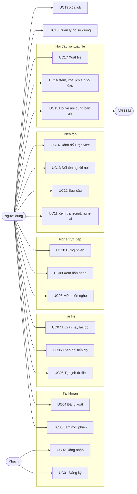
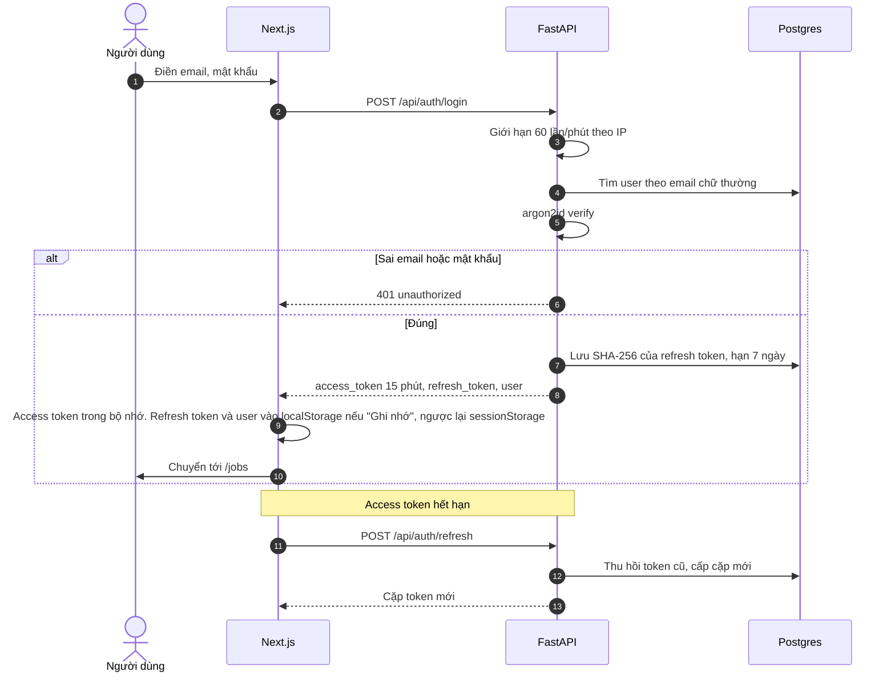
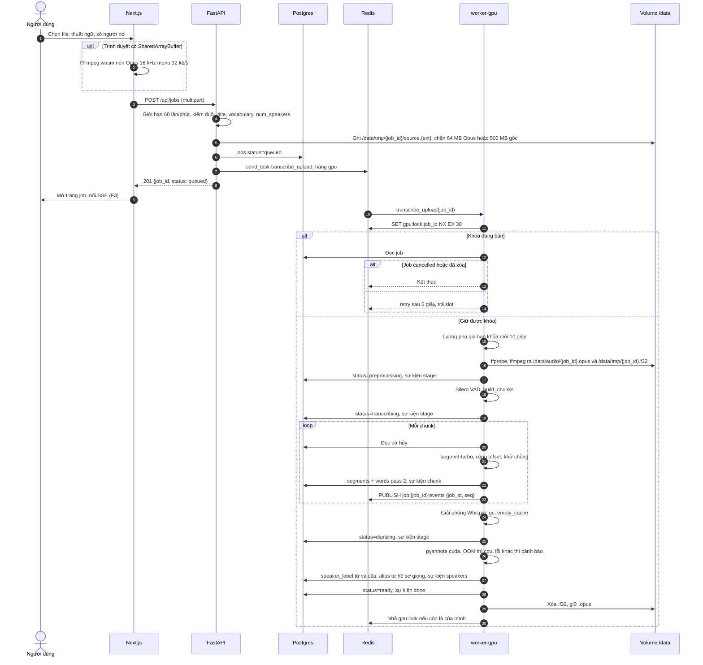
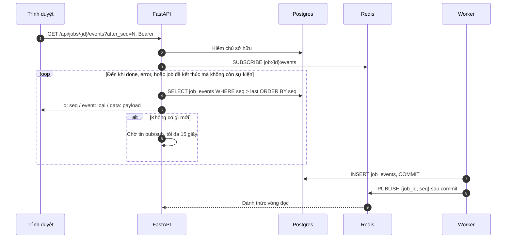
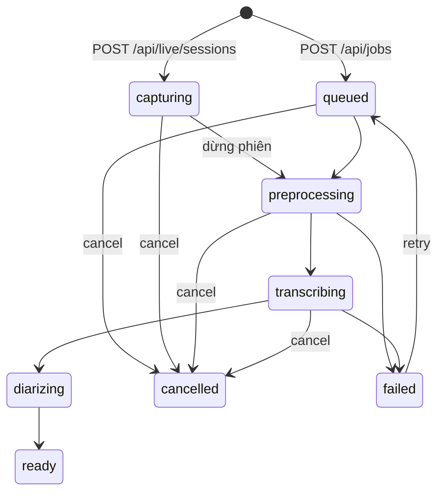
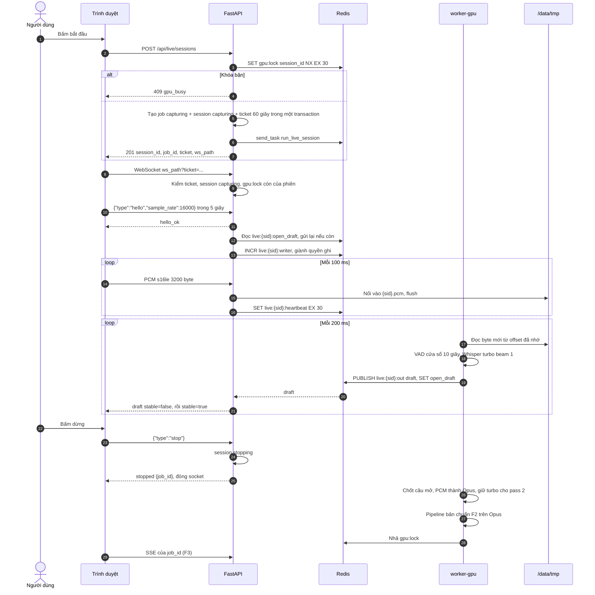
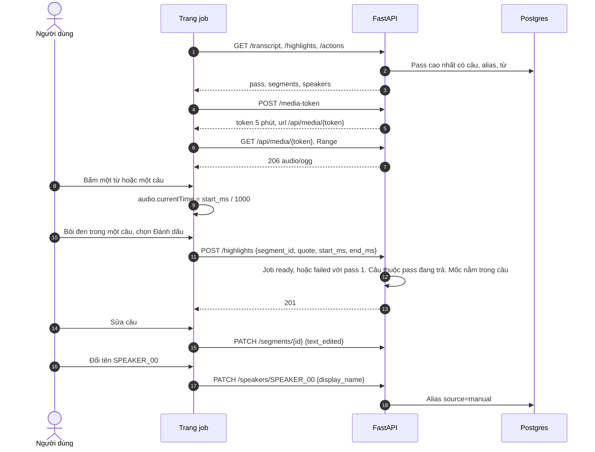
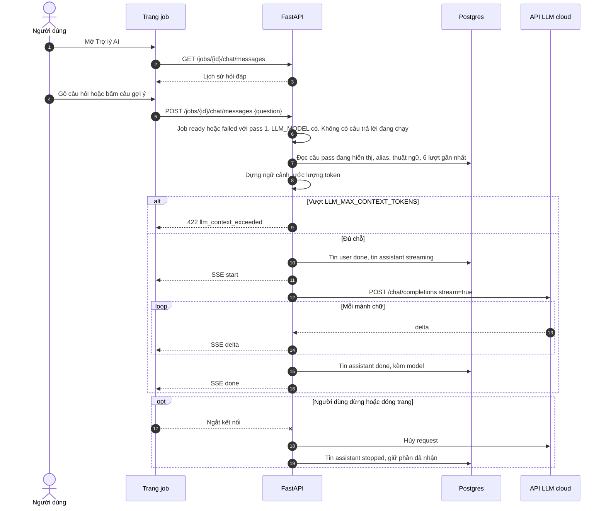
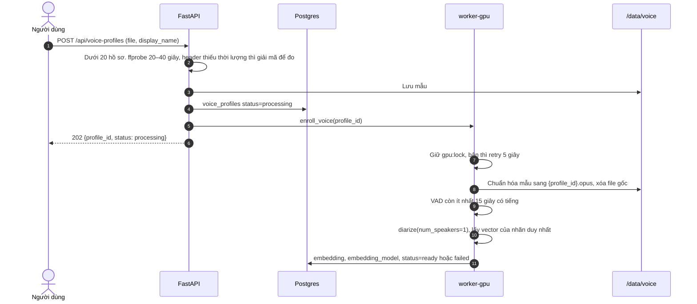

# Phân tích luồng

**Dự án:** Hệ thống trợ lý chuyển đổi, tóm tắt và trích xuất biên bản cuộc họp / bài giảng tiếng Việt  
**Phiên bản:** 1.4  
**Ngày:** 2026-10-28  
**Vai trò của file này:** Gom từng luồng nghiệp vụ thành một chỗ: ai làm gì, đi qua thành phần nào, dữ liệu nằm ở đâu, lỗi rẽ nhánh thế nào, và code hiện có tới đâu. Hợp đồng nằm ở [API và dữ liệu](API_AND_DATA.md). Thuật toán nằm ở [kiến trúc](ARCHITECTURE_SPEC.md). Khi file này lệch hai file đó, hai file đó đúng.

Cột "Hiện trạng" đối chiếu với commit `4cb3fc7` trên nhánh `feature/api-auth-ui`. Mục 13 gom các chỗ còn thiếu.

## 1. Tác nhân

| Tác nhân | Vai trò |
|---|---|
| Khách | Chưa đăng nhập. Chỉ đăng ký, đăng nhập, xem trang tĩnh |
| Người dùng | Đã đăng nhập. Sở hữu job, phiên nghe, hồ sơ giọng |
| Worker GPU | Tiến trình Celery hàng `gpu`: FFmpeg, VAD, Whisper, pyannote |
| API LLM | Gemini, qua endpoint tương thích OpenAI |
| Hugging Face | Nguồn tải model lần đầu, cần `HF_TOKEN` cho pyannote |

Bản này không có vai trò quản trị.

## 2. Use case

| Mã | Use case | Điều kiện trước | Kết quả | Luồng |
|---|---|---|---|---|
| UC01 | Đăng ký | Email chưa dùng | Tài khoản và cặp token | [F1](#3-f1-tài-khoản) |
| UC02 | Đăng nhập | Có tài khoản | Cặp token | F1 |
| UC03 | Làm mới phiên | Refresh token còn hạn, chưa thu hồi | Cặp token mới, token cũ thu hồi | F1 |
| UC04 | Đăng xuất | Có refresh token | Token bị thu hồi | F1 |
| UC05 | Tạo job từ file | Đăng nhập | Job `queued`, task trên hàng `gpu` | [F2](#4-f2-tải-file-pt1) |
| UC06 | Theo dõi tiến độ | Job thuộc người dùng | Khung SSE theo `seq` | [F3](#5-f3-sse-tiến-độ-và-tải-lại-trang) |
| UC07 | Hủy / chạy lại | Trạng thái cho phép | Job `cancelled` hoặc `queued` | [F4](#6-f4-hủy-chạy-lại-xóa) |
| UC08 | Mở phiên nghe | GPU rảnh | Session, job `capturing`, ticket WS | [F5](#7-f5-nghe-trực-tiếp-pt2) |
| UC09 | Xem bản nháp | Socket đang mở | Tin `draft` | F5 |
| UC10 | Dừng phiên | Session `capturing` | Pass 2 trên file đã thu | F5 |
| UC11 | Xem transcript, nghe lại | Job có câu | Transcript, media token | [F6](#8-f6-xem-sửa-đánh-dấu-nghe-lại) |
| UC12 | Sửa câu | Job `ready`, hoặc `failed` với pass 1 | `text_edited` | F6 |
| UC13 | Đổi tên người nói | Như UC12, nhãn có trong pass đang trả | Alias `manual` | F6 |
| UC14 | Đánh dấu, tạo việc | Như UC12 | Dòng `highlights` / `action_items` | F6 |
| UC15 | Hỏi về nội dung | Như UC12, có `LLM_MODEL` | Câu trả lời kèm mốc, lưu `chat_messages` | [F7](#9-f7-hỏi-đáp-với-llm) |
| UC16 | Xem, xóa lịch sử hỏi đáp | Job thuộc người dùng | Danh sách tin nhắn, hoặc lịch sử bị xóa | F7 |
| UC17 | Xuất file | Như UC12 | File md, docx, pdf, srt, vtt | [F8](#10-f8-xuất-file) |
| UC18 | Hồ sơ giọng | Dưới 20 hồ sơ | Vector giọng | [F9](#11-f9-hồ-sơ-giọng) |
| UC19 | Xóa job | Job thuộc người dùng | Dòng và file bị gỡ | F4 |

Mọi use case từ UC03 trở đi đọc `user_id` từ token. Id thuộc người khác trả `404`, giống id không tồn tại.

## 3. F1. Tài khoản

Đăng ký đi cùng đường, trả `201` và cùng body với đăng nhập. Email trùng trả `validation` trên field `email`. Đăng xuất thu hồi refresh token và trả `204`. Client tự xóa access token.

Các nhánh lỗi: body không phải JSON object trả `bad_request`. Quá 60 request mỗi phút từ một IP trên `login` hoặc `register` trả `429 rate_limited`. Bộ đếm nằm trong tiến trình FastAPI, nên nhiều bản uvicorn thì mỗi bản đếm riêng.

| Phần | Hiện trạng |
|---|---|
| API register, login, refresh, logout, me | Có, có test |
| Trang `/login`, `/register` | Có, gọi API thật |
| Trang `/forgot-password` | Chỉ giao diện, giả lập chờ 600 ms. Đặt lại mật khẩu nằm ngoài phạm vi bản này |
| Nút đăng nhập Google | Hiện thông báo chưa hỗ trợ |
| Tự gọi refresh khi access token hết hạn | Có. `lib/api.ts` hẹn làm mới trước hạn 60 giây, gặp 401 thì làm mới rồi thử lại một lần, tải lại trang thì lấy access token bằng refresh token. Nhiều tab xoay token tuần tự qua `navigator.locks` |

## 4. F2. Tải file, PT1

Hằng số chunk, tham số Whisper, và luật gán nhãn nằm ở kiến trúc mục 2.3 đến 2.5.

Nhánh lỗi:

| Khi | Kết quả |
|---|---|
| Đuôi file không có trong danh sách | `422 validation` trên `file` |
| Vượt dung lượng khi đang ghi | `413 file_too_large`, thư mục tạm bị xóa |
| `ffprobe` không thấy audio | Job `failed`, `error_code = unsupported_media` |
| Dài hơn 3 giờ hoặc PCM ước lượng quá 800 MB | Job `failed`, `duration_exceeded`, không còn `.f32` |
| Không nạp được Whisper | Job `failed`, `gpu_oom` |
| VAD không thấy tiếng | Job `ready`, transcript rỗng |
| pyannote lỗi cả GPU lẫn CPU | Job `ready`, `warnings` có `diarization_failed`, nhãn null |
| Thấy cờ hủy giữa hai chunk | Dừng, giữ câu đã ghi, nhả model và khóa, job `cancelled` |

| Phần | Hiện trạng |
|---|---|
| `POST /api/jobs`, kiểm field, ghi file tạm, enqueue | Có, có test |
| `run_standard_pass`: stage, chunk, khử chồng, cờ hủy, diarization, alias, sự kiện | Có, test bằng hàm `transcribe` và `diarize` giả |
| Lấy khóa, `retry` 5 giây, gia hạn khóa | Có |
| FFmpeg, ffprobe, Silero, Whisper, pyannote thật | Có. `run_upload_job` chuẩn hóa, VAD, nhận dạng, gán người nói. Test dùng FFmpeg thật, Whisper và pyannote giả. Ngày 2026-10-29 đã chạy `large-v3-turbo` int8 và pyannote trên CUDA, RTX 4050 Laptop 6GB: bài 9 phút 41 giây xong sau 85 giây, bài 86 phút xong sau 545 giây, đỉnh VRAM toàn card khoảng 3,1GB. Số liệu ở `backend/MODELS.lock` |
| Ghi `audio_path`, `duration_ms` | Có. Xóa `/data/tmp/{job_id}/` sau khi có Opus. Chạy lại và lần giao lại của Celery dùng Opus canonical |
| Ghi nhãn bằng cập nhật hàng loạt | Có. Hai lệnh `UPDATE` theo khóa chính, một cho từ, một cho câu |
| Nén FFmpeg.wasm, hộp thoại tạo bản ghi | Có, chạy nền trong tab, tiến độ ở menu trái. WASM lỗi thì tải file gốc. Worker của ffmpeg.wasm chạy bản chép trong `public/ffmpeg`, vì webpack làm hỏng `import(coreURL)` trong worker đã bundle |

## 5. F3. SSE tiến độ và tải lại trang

Tin pub/sub chỉ là tín hiệu đánh thức. Nội dung luôn đọc từ Postgres, nên tin bị mất hoặc tới trễ không làm hổng `seq`. Worker publish trong hook `after_commit` của SQLAlchemy, nên SSE không bao giờ được đánh thức trước khi dòng sự kiện đọc được.

Tải lại trang:

1. Gọi `GET /api/jobs/{id}/transcript` để vẽ các câu đã có.
2. Lấy `seq` lớn nhất đã áp dụng. Trình duyệt chưa lưu thì dùng `0` và bỏ các câu trùng `id`.
3. Mở lại SSE với `after_seq` đó.

Stream tự đóng khi gửi xong `done` hoặc `error`, hoặc khi job đã `ready`, `failed`, `cancelled` và không còn sự kiện mới. Client nhận `done` thì xả hàng đợi typewriter với nhịp 15 ms.

| Phần | Hiện trạng |
|---|---|
| Endpoint SSE, header, đọc bù từ Postgres, pub/sub | Có, có test |
| Đánh thức trong tiến trình khi chạy không có Redis | Có, dùng cho test |
| Client SSE bằng `fetch`, `AdaptiveTypewriter` | Có. Typewriter hẹn giờ theo mốc tuyệt đối: 50 từ với 2000 ms xả trong khoảng 1970 ms |

## 6. F4. Hủy, chạy lại, xóa

| Thao tác | Nhận trạng thái | Việc server làm |
|---|---|---|
| `POST .../cancel` | `queued`, `capturing`, `preprocessing`, `transcribing` | Đặt `cancelled`, `finished_at`. Nếu đang `capturing`: đóng phiên, dừng gia hạn và nhả `gpu:lock`, session `failed`, xóa PCM. Worker thấy cờ ở chunk kế tiếp |
| `POST .../retry` | `failed` | Xóa câu và từ pass 2, xóa đánh dấu trên các câu đó, tách `segment_id` của việc `manual` khỏi câu bị xóa. Giữ pass 1. Đặt lại lỗi và mốc thời gian, `queued`, enqueue `transcribe_upload` |
| `DELETE /api/jobs/{id}` | Mọi trạng thái | Nếu đang `capturing` thì dừng thu như hủy. Xóa thư mục `/data/tmp/{job_id}`, file Opus, rồi xóa job. Khóa ngoại `cascade` gỡ các bảng con |

Trạng thái khác trả `409 invalid_state`.

Chạy lại một job live dùng cùng task `transcribe_upload`, đầu vào là Opus canonical của phiên. Task đó phải nhận được cả hai nguồn: file gốc trong `/data/tmp/{job_id}/` và `/data/audio/{job_id}.opus`.

| Phần | Hiện trạng |
|---|---|
| Ba endpoint | Có, có test |
| Worker dừng thật khi job bị hủy giữa chừng | Có trong `run_standard_pass` |

## 7. F5. Nghe trực tiếp, PT2

Nối lại: socket rớt dưới 30 giây thì client gọi `POST /api/live/sessions/{sid}/ticket` lấy ticket mới và mở lại socket. Socket mới tăng `live:{sid}:writer`. Socket cũ thấy mình không còn là người ghi thì thôi ghi và đóng, nên file PCM không bao giờ có hai nguồn ghi xen nhau.

Mất kết nối quá 30 giây, hoặc client gọi `POST /api/live/sessions/{sid}/stop` khi không còn socket, đều dẫn tới bước dừng như trên.

Mã lỗi trên socket:

| `code` | Khi |
|---|---|
| `unauthorized` | Ticket sai, hết hạn, khác session, hoặc session không còn `capturing` |
| `gpu_busy` | Khóa đã thuộc id khác |
| `hello_timeout` | Không có tin `hello` trong 5 giây |
| `bad_request` | Tin đầu không phải `hello` 16000, khung PCM lẻ byte hoặc ngoài 20–200 ms, hoặc tin text không đọc được |
| `payload_too_large` | Tổng PCM vượt `MAX_DURATION_SECONDS` |
| `invalid_state` | Phiên đã đóng khi đang giành quyền ghi |

Server đóng socket ngay sau mỗi tin `error`.

| Phần | Hiện trạng |
|---|---|
| Tạo session, job, ticket, khóa GPU | Có, có test |
| WebSocket: hello, ghi PCM, heartbeat, một người ghi, đọc lại `open_draft`, stop | Có, có test |
| Kênh xuống `live:{sid}:out` phía FastAPI | Có (`LiveFeed`) |
| `run_live_session`: đọc PCM, VAD, Whisper turbo, phát `draft` | Có, `services/live_worker.py`, có test với VAD và Whisper giả. Đã chạy qua Caddy trên GPU với 45 giây cuộc họp |
| Chuyển session `stopping` → `finalized`, job `capturing` → `preprocessing`, chạy pass 2 | Có, trong cùng tác vụ, có test. Lần giao lại chạy lại pass 2 trên Opus |
| Nhả khóa khi mất heartbeat | Worker giữ khóa tới hết pass 2 và đặt `live:{sid}:worker`. `LockKeeper(until_quiet=True)` của FastAPI chỉ nhả khóa khi chưa có worker nào nhận phiên |
| Thu micro, chia sẻ tab, AudioWorklet, trang `/live` | Có: `public/pcm-worklet.js`, `lib/live-capture.ts`, trang `/live`. Nối lại bằng ticket mới khi rớt dưới 25 giây. Nhóm đã chạy thực tế trên trình duyệt với micro và worker GPU, ghi nhận 2026-11-04. Chia sẻ tab và rớt mạng chưa có lần thử được ghi lại |

## 8. F6. Xem, sửa, đánh dấu, nghe lại

Chữ hiện của một câu: `text_edited`, nếu null thì `text_raw`. Câu chưa sửa bấm được từng từ.

Media token hết hạn sau 5 phút. Trình phát nhận `404` thì trang xin token mới và gán lại `src` tại `currentTime` cũ. Trang chỉ xin lại khi `src` trước đã nạp được và lần xin lại gần nhất đã quá 5 phút. Không thì nó dừng nghe lại, nút phát báo chưa có file, còn transcript vẫn đọc được.

| Phần | Hiện trạng |
|---|---|
| Transcript, sửa câu, alias, đánh dấu, việc `manual`, media token, Range | Có, có test |
| Trang `/jobs/[id]` | Có, theo khung ba vùng ở kiến trúc mục 2.7. SSE, chạy chữ, nghe lại, đổi tên người nói, đánh dấu theo vùng bôi đen, tạo việc, hỏi trợ lý, xuất file, chia sẻ, cài đặt hiển thị, hủy, chạy lại, xóa, sửa câu. Nút bút chì ở đầu câu mở ô sửa: Lưu hoặc Ctrl + Enter, Hủy hoặc Esc, Về bản gốc gửi `text_edited: null`. Chữ trùng bản gốc cũng gửi `null`. Câu đã sửa mang nhãn "Đã sửa" |
| Liên kết chia sẻ, bảng `job_shares`, trang `/shared/[token]` | Có, có test API, đã chạy qua trình duyệt với backend trên SQLite |

## 9. F7. Hỏi đáp với LLM

| Mã lỗi | Khi |
|---|---|
| `llm_not_configured` | Thiếu `LLM_MODEL` hoặc `LLM_API_KEY`, trả ngay, không tạo tin nhắn |
| `llm_context_exceeded` | Ngữ cảnh vượt `LLM_MAX_CONTEXT_TOKENS`, trả ngay, không gọi LLM |
| `chat_busy` | Bản ghi đang có một câu trả lời chạy |
| `llm_timeout` | Quá `LLM_TIMEOUT_SECONDS` không có mảnh chữ mới |
| `llm_rate_limited` | API LLM trả 429, thường do hết hạn mức |
| `llm_upstream` | Lỗi kết nối hoặc lỗi HTTP khác từ API LLM |

Lỗi trong lúc đang stream đi bằng sự kiện `error`, tin nhắn thành `failed` và giữ phần đã nhận. Lượt `stopped` hoặc `failed` không vào ngữ cảnh của câu sau. Chạy lại job xóa lịch sử hỏi đáp. Xóa job xóa theo khóa ngoại.

Bấm mốc `[MM:SS]` trong câu trả lời thì tua tới đó. Câu hỏi và transcript được gửi tới nhà cung cấp LLM mỗi lần hỏi.

| Phần | Hiện trạng |
|---|---|
| Hỏi đáp, panel `Trợ lý AI`, bảng `chat_messages` | Có, có test với LLM giả và đã chạy qua trình duyệt với server giả |
| Chạy với model thật | Có. Ngày 2026-11-02 đã hỏi `gemini-3.5-flash-lite` trên bài 90 giây, chữ đầu tiên sau 2,6 giây. Chưa đo trên bộ đối chiếu |

## 10. F8. Xuất file

`POST /api/jobs/{id}/exports` trả thẳng file. Điều kiện giống F6. `text = auto` theo thứ tự hiện chữ. Markdown và DOCX đặt việc `manual` lên đầu, rồi đánh dấu, rồi transcript. Lịch sử hỏi đáp không vào file xuất. SRT và VTT một cue một câu.

| Phần | Hiện trạng |
|---|---|
| md, docx, pdf có Noto Sans, srt, vtt | Có, có test |

## 11. F9. Hồ sơ giọng

Hồ sơ được dùng ở cuối F2: mỗi nhãn trong buổi so tích vô hướng với các hồ sơ `ready` cùng `embedding_model`. Đạt `VOICE_MATCH_THRESHOLD` và cách điểm kế tiếp ít nhất `VOICE_MATCH_MARGIN` thì ghi alias `voice_profile`. Alias `manual` không bị đổi.

| Phần | Hiện trạng |
|---|---|
| API list, get, create, delete, kiểm thời lượng | Có |
| So khớp hồ sơ trong pipeline | Có (`speaker_align.match_speakers`), có test |
| `enroll_voice` tính vector | Có (`services/voice_profile.run_enroll`), có test với FFmpeg thật, VAD và pyannote giả. Chưa đo điểm giống trên mẫu thật của nhóm |
| Trang `/voice-profiles` | Có. Thu bằng micro theo đoạn văn mẫu, hoặc chọn file. Danh sách hỏi lại mỗi 3 giây khi còn hồ sơ `processing`, hiện lý do lỗi và nhãn cần thu lại khi `stale`, xóa có bước xác nhận |

## 12. Nơi giữ trạng thái

### Redis

| Key / kênh | Ai ghi | Ai đọc | Sống |
|---|---|---|---|
| `gpu:lock` | API lúc mở phiên, worker GPU | Mọi task GPU, WebSocket | `EX 30`, gia hạn mỗi 10 giây |
| `job:{job_id}:events` (pub/sub) | Tiến trình commit `job_events` | SSE | Không lưu |
| `live:{sid}:heartbeat` | WebSocket | Worker phiên, `LockKeeper` | 30 giây |
| `live:{sid}:writer` | WebSocket, `INCR` mỗi lần nối | WebSocket | Đến khi xóa |
| `live:{sid}:closed` | Hủy hoặc xóa job | WebSocket | 120 giây |
| `live:{sid}:out` (pub/sub) | Worker phiên | WebSocket | Không lưu |
| `live:{sid}:open_draft` | Worker phiên | WebSocket khi nối lại | 60 giây |
| `live:{sid}:worker` | Worker phiên, mỗi 10 giây | `LockKeeper` của FastAPI | 30 giây |

Không có `REDIS_URL` thì các key trên nằm trong bộ nhớ tiến trình. Chế độ này chỉ dùng cho test, vì API và worker là hai tiến trình.

### Volume `/data`

| Đường dẫn | Nội dung | Xóa khi |
|---|---|---|
| `/data/tmp/{job_id}/source.{ext}` | File người dùng tải lên | Worker đã tạo Opus canonical, hoặc xóa job |
| `/data/tmp/{job_id}.f32` | PCM float32 cho model | Job sang `ready`, `failed`, `cancelled` |
| `/data/audio/{job_id}.opus` | Bản nghe lại canonical | Xóa job |
| `/data/tmp/{session_id}.pcm` | PCM s16le của phiên nghe | Session `finalized` hoặc `failed` |
| `/data/voice/{user_id}/{profile_id}.{ext}` | Mẫu giọng. API lưu đuôi file gốc, worker chuẩn hóa sang `.opus` rồi xóa file gốc | Xóa hồ sơ |

## 13. Khoảng trống giữa đặc tả và code

Xếp theo mức chặn demo. Cập nhật 2026-11-05.

| # | Mức | Khoảng trống | Ảnh hưởng | Chỗ sửa |
|---|---|---|---|---|
| 23 | Cao | Chưa đo hỏi đáp trên bộ đối chiếu | Chưa biết chất lượng câu trả lời, độ đúng của mốc, và chi phí trên bài dài | Đo theo ý tưởng mục 6 |
| 19 | Cao | `large-v3-turbo` bỏ trống những đoạn có lời nói | Bài tin y tế còn 14,5 giây tiếng nói không ra chữ sau khi sửa #16. Trên bài giảng và cuộc họp thật ngày 2026-11-03, turbo mất 2.073 từ so với 849 của PhoWhisper, có đoạn trống liền 108 giây. Đây là phần lớn mức chênh CER giữa hai model. Model bỏ với `no_speech_prob` bằng 0, nên ngưỡng và dải `temperature` không cứu được. Nhận dạng riêng từng vùng VAD thì lấy lại được | Đã có bước vá trong `vad_chunker.fill_empty_spans`: vùng VAD trống từ 1,5 giây được nhận dạng riêng. Còn đo lại trên bộ dữ liệu thực tế ở `Báo Cáo/do-cer-2026-11-03/`. Ở bài `acid`, phần lớn đoạn trống dài là do VAD chỉ thấy tiếng rải rác và Whisper không ra chữ cả khi cắt cửa sổ 10 giây, nên bước vá không lấy lại được |
| 20 | Trung bình | Nền có người nói làm mất chữ | Trộn tiếng người nói lẫn nhau: WER 13% ở 10 dB, 30% ở 5 dB, gần như mất hết ở 0 dB. Nhiễu đều chịu được tới 10 dB. Lọc nhiễu `afftdn` chỉ giúp nhiễu đều mạnh | Đo trên ghi âm họp thật. Cân nhắc #19 và tách nguồn trước khi nhận dạng |
| 18 | Trung bình | Câu của Whisper chứa từ của nhiều nhãn | Trên GPU, 39/126 câu của bài 9 phút và 553/1287 câu của bài 86 phút có từ mang nhãn khác nhãn câu, kể cả từ null. Câu hiện cả câu dưới một người nói | Hướng tối ưu ở kiến trúc mục 2.5: tách câu tại chỗ đổi nhãn, gán từ null cho lượt gần nhất. Đo lại sau khi sửa |
| 9 | Thấp | `rate_limit` đếm trong tiến trình | Nhiều bản uvicorn thì trần nhân lên | Chuyển sang Redis nếu chạy nhiều bản |
| 17 | Thấp | SSE không có Redis chỉ đánh thức trong cùng tiến trình | Worker ở tiến trình khác thì chữ tới sau tối đa 15 giây. Chỉ gặp khi chạy thử không có Redis | Không cần sửa cho triển khai Compose |

Đã đóng ngày 2026-10-29: #1 pipeline PT1 thật, #3 phần `/jobs`, `/jobs/new`, `/jobs/[id]`, #5 tự làm mới token, #6 cấu hình Celery, #8 ghi nhãn hàng loạt, #11 xóa file gốc sau khi có Opus, #13 đọc từ trong một truy vấn, #14 `max(seq)`, #12 bộ phiên bản chạy trên card thật. Lúc kiểm #12 đã sửa ba lỗi chỉ lộ ra trên GPU: image nền trixie làm `ctranslate2` không nạp được, pip thay torch cu121 bằng torch mới trên PyPI, và worker khởi tạo CUDA ở tiến trình cha nên tiến trình fork của Celery không nạp được Whisper. Cũng ngày đó đóng #16: bộ lọc chữ bịa thêm `hallucination_silence_threshold`, ngưỡng tốc độ nói và luật lời mời đăng ký kênh, kèm sửa chữ số bị tách thành `150 .000`. Số đo ở kiến trúc mục 2.4 và trong `Báo Cáo/`.

Đã đóng ngày 2026-11-05: #21 ô sửa câu trong `transcript-layout.tsx`, gọi `PATCH /segments/{id}`. Đã thử trên trình duyệt với backend trên SQLite: lưu, tải lại trang, hủy, về bản gốc.

Đã đóng ngày 2026-11-04: #4 `enroll_voice` tính vector bằng chính `diarization.diarize` với một người nói, nên vector so được với vector cụm của `cluster_vectors`, và phần `/voice-profiles` của #3.

Đã đóng ngày 2026-11-03: #2 vòng nháp và bàn giao sang pass 2 trong `run_live_session`, #7 nhả khóa của phiên chuyển về worker, và phần `/live` của #3. Lúc đóng, cả ba mới có test với model giả. Ngày 2026-11-04 nhóm đã chạy PT2 thực tế trên trình duyệt với micro và worker GPU.

## 14. Thứ tự làm tiếp đề xuất

1. Thử nốt PT2 ở các tình huống chưa ghi nhận: chia sẻ tab, rớt mạng dưới 30 giây. Đo độ trễ câu nháp theo [ý tưởng mục 6](IDEA_AND_CHALLENGES.md#6-tiêu-chí-nghiệm-thu). Micro trên trình duyệt thật và GPU đã chạy ngày 2026-11-04.
2. Đo lại #19, rồi đo `large-v3-turbo` có nhập thuật ngữ trên các bài chuyên ngành. Chạy lại bộ dữ liệu thực tế ở `Báo Cáo/do-cer-2026-11-03/` để khóa model bản chuẩn. Hai vòng đo trước, trên tin VTV24 và trên bài giảng, cuộc họp đăng mạng, đều ở `Báo Cáo/`. Ghi âm họp do nhóm tự thu vẫn cần cho #20.
3. Cơ chế nhường GPU ở kiến trúc mục 1, để file dài không chặn phiên nghe mới.
4. Đo điểm giống của hồ sơ giọng trên mẫu thu của nhóm, so với giọng cùng người trong ghi âm họp, để chỉnh `VOICE_MATCH_THRESHOLD`.
5. #23.
6. #18, sau khi có số đo, rồi các mục còn lại.
