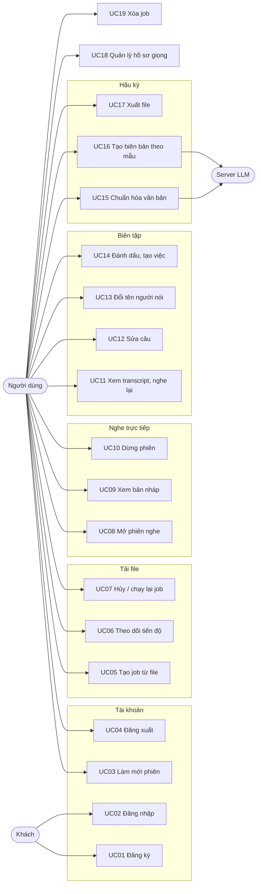
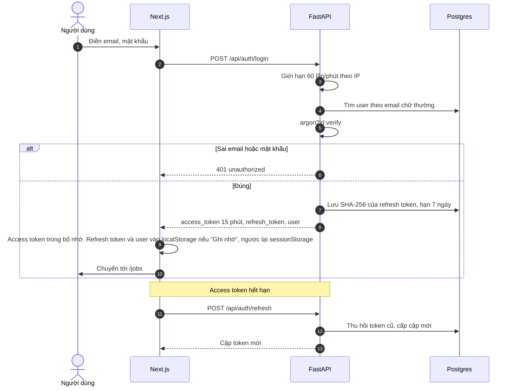
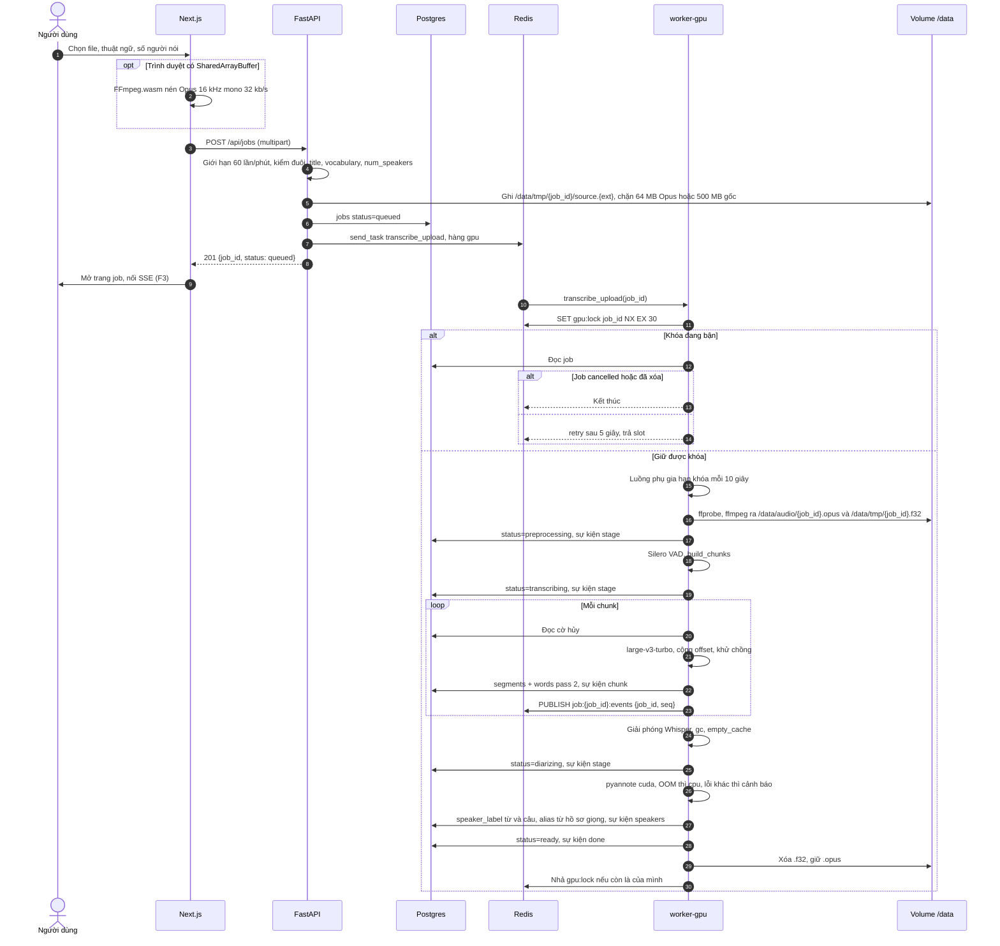
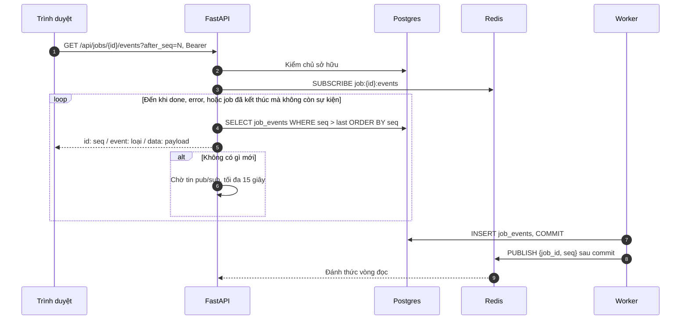
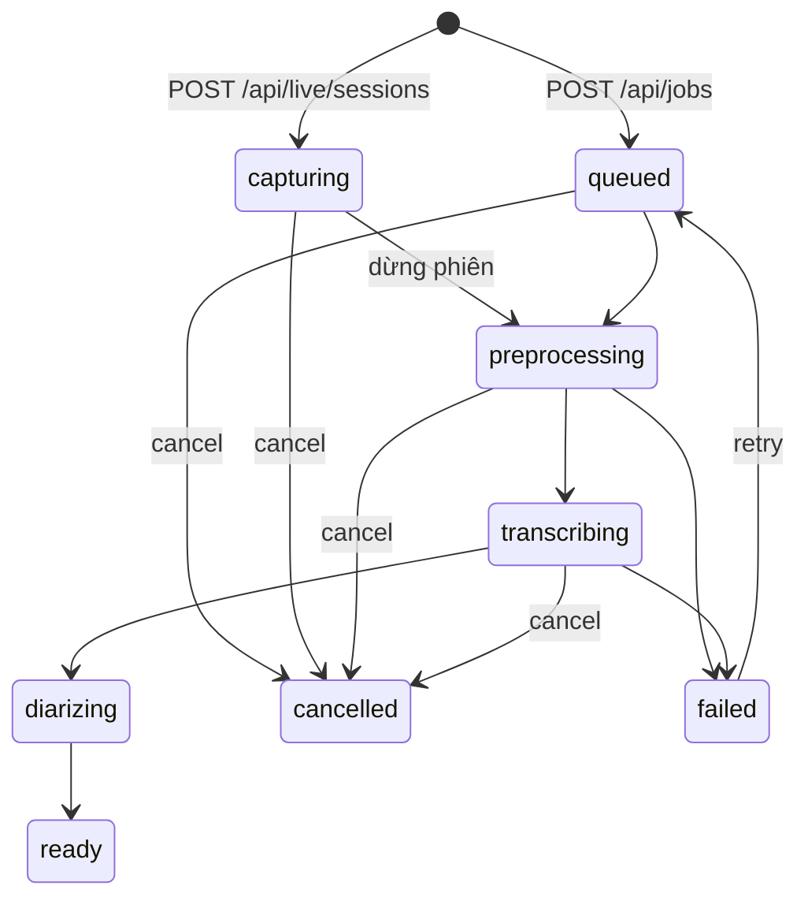
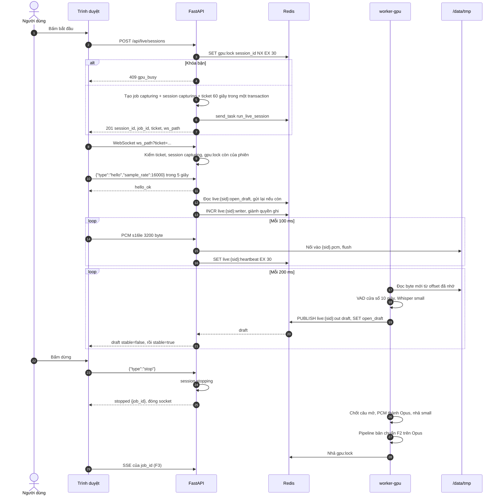
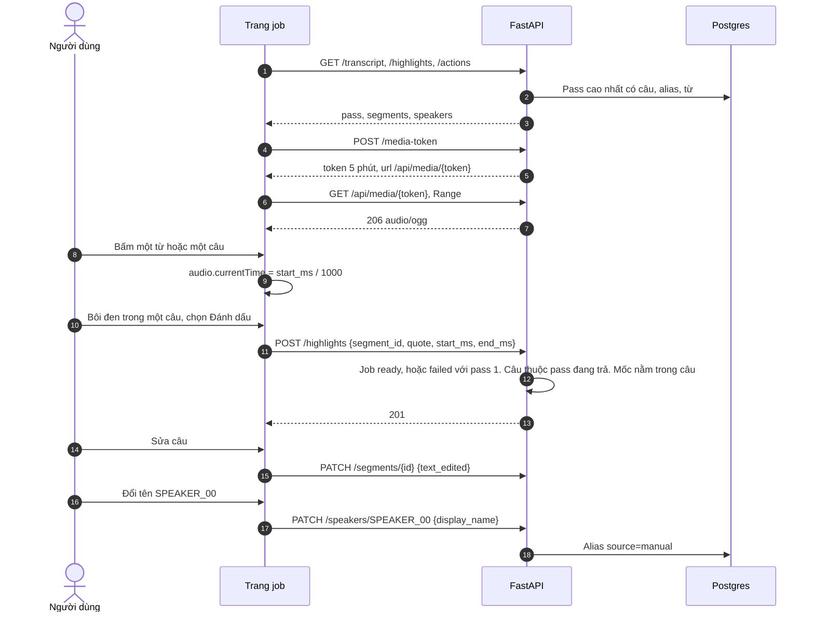
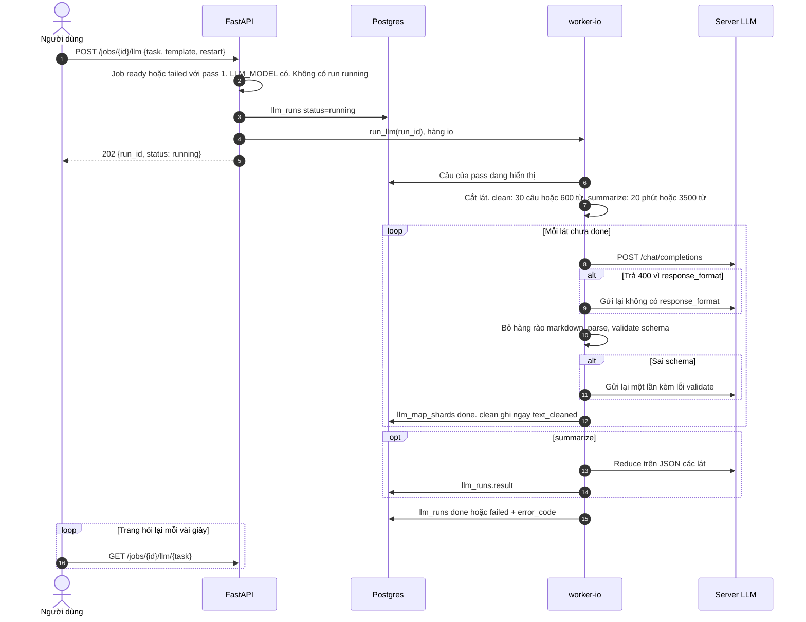
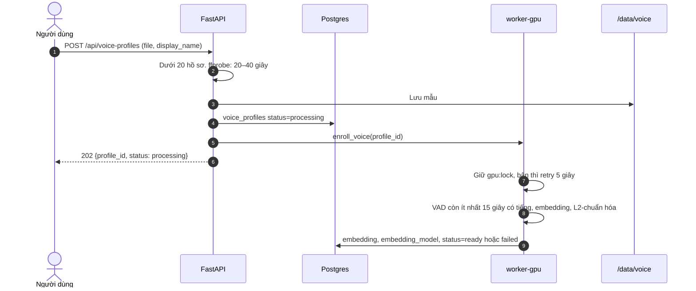

# Phân tích luồng

**Dự án:** Hệ thống trợ lý chuyển đổi, tóm tắt và trích xuất biên bản cuộc họp / bài giảng tiếng Việt  
**Phiên bản:** 1.4  
**Ngày:** 2026-10-28  
**Vai trò của file này:** Gom từng luồng nghiệp vụ thành một chỗ: ai làm gì, đi qua thành phần nào, dữ liệu nằm ở đâu, lỗi rẽ nhánh thế nào, và code hiện có tới đâu. Hợp đồng nằm ở [API và dữ liệu](API_AND_DATA.md). Thuật toán nằm ở [kiến trúc](ARCHITECTURE_SPEC.md). Khi file này lệch hai file đó, hai file đó đúng.

Cột "Hiện trạng" đối chiếu với commit `4cb3fc7` trên nhánh `feature/api-auth-ui`. Mục 13 gom các chỗ còn thiếu.

## 1. Tác nhân

| Tác nhân | Vai trò |
|---|---|
| Khách | Chưa đăng nhập. Chỉ đăng ký, đăng nhập, xem trang tĩnh |
| Người dùng | Đã đăng nhập. Sở hữu job, phiên nghe, hồ sơ giọng |
| Worker GPU | Tiến trình Celery hàng `gpu`: FFmpeg, VAD, Whisper, pyannote |
| Worker IO | Tiến trình Celery hàng `io`: gọi LLM |
| Server LLM | Dịch vụ ngoài, tương thích OpenAI |
| Hugging Face | Nguồn tải model lần đầu, cần `HF_TOKEN` cho pyannote |

Bản này không có vai trò quản trị.

## 2. Use case

| Mã | Use case | Điều kiện trước | Kết quả | Luồng |
|---|---|---|---|---|
| UC01 | Đăng ký | Email chưa dùng | Tài khoản và cặp token | [F1](#3-f1-tài-khoản) |
| UC02 | Đăng nhập | Có tài khoản | Cặp token | F1 |
| UC03 | Làm mới phiên | Refresh token còn hạn, chưa thu hồi | Cặp token mới, token cũ thu hồi | F1 |
| UC04 | Đăng xuất | Có refresh token | Token bị thu hồi | F1 |
| UC05 | Tạo job từ file | Đăng nhập | Job `queued`, task trên hàng `gpu` | [F2](#4-f2-tải-file-pt1) |
| UC06 | Theo dõi tiến độ | Job thuộc người dùng | Khung SSE theo `seq` | [F3](#5-f3-sse-tiến-độ-và-tải-lại-trang) |
| UC07 | Hủy / chạy lại | Trạng thái cho phép | Job `cancelled` hoặc `queued` | [F4](#6-f4-hủy-chạy-lại-xóa) |
| UC08 | Mở phiên nghe | GPU rảnh | Session, job `capturing`, ticket WS | [F5](#7-f5-nghe-trực-tiếp-pt2) |
| UC09 | Xem bản nháp | Socket đang mở | Tin `draft` | F5 |
| UC10 | Dừng phiên | Session `capturing` | Pass 2 trên file đã thu | F5 |
| UC11 | Xem transcript, nghe lại | Job có câu | Transcript, media token | [F6](#8-f6-xem-sửa-đánh-dấu-nghe-lại) |
| UC12 | Sửa câu | Job `ready`, hoặc `failed` với pass 1 | `text_edited` | F6 |
| UC13 | Đổi tên người nói | Như UC12, nhãn có trong pass đang trả | Alias `manual` | F6 |
| UC14 | Đánh dấu, tạo việc | Như UC12 | Dòng `highlights` / `action_items` | F6 |
| UC15 | Chuẩn hóa | Như UC12, có `LLM_MODEL` | `text_cleaned` | [F7](#9-f7-hậu-kỳ-llm) |
| UC16 | Biên bản | Như UC15 | `llm_runs.result` theo mẫu | F7 |
| UC17 | Xuất file | Như UC12 | File md, docx, pdf, srt, vtt | [F8](#10-f8-xuất-file) |
| UC18 | Hồ sơ giọng | Dưới 20 hồ sơ | Vector giọng | [F9](#11-f9-hồ-sơ-giọng) |
| UC19 | Xóa job | Job thuộc người dùng | Dòng và file bị gỡ | F4 |

Mọi use case từ UC03 trở đi đọc `user_id` từ token. Id thuộc người khác trả `404`, giống id không tồn tại.

## 3. F1. Tài khoản

Đăng ký đi cùng đường, trả `201` và cùng body với đăng nhập. Email trùng trả `validation` trên field `email`. Đăng xuất thu hồi refresh token và trả `204`. Client tự xóa access token.

Các nhánh lỗi: body không phải JSON object trả `bad_request`. Quá 60 request mỗi phút từ một IP trên `login` hoặc `register` trả `429 rate_limited`. Bộ đếm nằm trong tiến trình FastAPI, nên nhiều bản uvicorn thì mỗi bản đếm riêng.

| Phần | Hiện trạng |
|---|---|
| API register, login, refresh, logout, me | Có, có test |
| Trang `/login`, `/register` | Có, gọi API thật |
| Trang `/forgot-password` | Chỉ giao diện, giả lập chờ 600 ms. Đặt lại mật khẩu nằm ngoài phạm vi bản này |
| Nút đăng nhập Google | Hiện thông báo chưa hỗ trợ |
| Tự gọi refresh khi access token hết hạn | Có. `lib/api.ts` hẹn làm mới trước hạn 60 giây, gặp 401 thì làm mới rồi thử lại một lần, tải lại trang thì lấy access token bằng refresh token. Nhiều tab xoay token tuần tự qua `navigator.locks` |

## 4. F2. Tải file, PT1

Hằng số chunk, tham số Whisper, và luật gán nhãn nằm ở kiến trúc mục 2.3 đến 2.5.

Nhánh lỗi:

| Khi | Kết quả |
|---|---|
| Đuôi file không có trong danh sách | `422 validation` trên `file` |
| Vượt dung lượng khi đang ghi | `413 file_too_large`, thư mục tạm bị xóa |
| `ffprobe` không thấy audio | Job `failed`, `error_code = unsupported_media` |
| Dài hơn 3 giờ hoặc PCM ước lượng quá 800 MB | Job `failed`, `duration_exceeded`, không còn `.f32` |
| Không nạp được Whisper | Job `failed`, `gpu_oom` |
| VAD không thấy tiếng | Job `ready`, transcript rỗng |
| pyannote lỗi cả GPU lẫn CPU | Job `ready`, `warnings` có `diarization_failed`, nhãn null |
| Thấy cờ hủy giữa hai chunk | Dừng, giữ câu đã ghi, nhả model và khóa, job `cancelled` |

| Phần | Hiện trạng |
|---|---|
| `POST /api/jobs`, kiểm field, ghi file tạm, enqueue | Có, có test |
| `run_standard_pass`: stage, chunk, khử chồng, cờ hủy, diarization, alias, sự kiện | Có, test bằng hàm `transcribe` và `diarize` giả |
| Lấy khóa, `retry` 5 giây, gia hạn khóa | Có |
| FFmpeg, ffprobe, Silero, Whisper, pyannote thật | Có. `run_upload_job` chuẩn hóa, VAD, nhận dạng, gán người nói. Test dùng FFmpeg thật, Whisper và pyannote giả. Ngày 2026-10-29 đã chạy `large-v3-turbo` int8 và pyannote trên CUDA, RTX 4050 Laptop 6GB: bài 9 phút 41 giây xong sau 85 giây, bài 86 phút xong sau 545 giây, đỉnh VRAM toàn card khoảng 3,1GB. Số liệu ở `backend/MODELS.lock` |
| Ghi `audio_path`, `duration_ms` | Có. Xóa `/data/tmp/{job_id}/` sau khi có Opus. Chạy lại và lần giao lại của Celery dùng Opus canonical |
| Ghi nhãn bằng cập nhật hàng loạt | Có. Hai lệnh `UPDATE` theo khóa chính, một cho từ, một cho câu |
| Nén FFmpeg.wasm, trang `/jobs/new` | Có. WASM lỗi thì tải file gốc. Worker của ffmpeg.wasm chạy bản chép trong `public/ffmpeg`, vì webpack làm hỏng `import(coreURL)` trong worker đã bundle |

## 5. F3. SSE tiến độ và tải lại trang

Tin pub/sub chỉ là tín hiệu đánh thức. Nội dung luôn đọc từ Postgres, nên tin bị mất hoặc tới trễ không làm hổng `seq`. Worker publish trong hook `after_commit` của SQLAlchemy, nên SSE không bao giờ được đánh thức trước khi dòng sự kiện đọc được.

Tải lại trang:

1. Gọi `GET /api/jobs/{id}/transcript` để vẽ các câu đã có.
2. Lấy `seq` lớn nhất đã áp dụng. Trình duyệt chưa lưu thì dùng `0` và bỏ các câu trùng `id`.
3. Mở lại SSE với `after_seq` đó.

Stream tự đóng khi gửi xong `done` hoặc `error`, hoặc khi job đã `ready`, `failed`, `cancelled` và không còn sự kiện mới. Client nhận `done` thì xả hàng đợi typewriter với nhịp 15 ms.

| Phần | Hiện trạng |
|---|---|
| Endpoint SSE, header, đọc bù từ Postgres, pub/sub | Có, có test |
| Đánh thức trong tiến trình khi chạy không có Redis | Có, dùng cho test |
| Client SSE bằng `fetch`, `AdaptiveTypewriter` | Có. Typewriter hẹn giờ theo mốc tuyệt đối: 50 từ với 2000 ms xả trong khoảng 1970 ms |

## 6. F4. Hủy, chạy lại, xóa

| Thao tác | Nhận trạng thái | Việc server làm |
|---|---|---|
| `POST .../cancel` | `queued`, `capturing`, `preprocessing`, `transcribing` | Đặt `cancelled`, `finished_at`. Nếu đang `capturing`: đóng phiên, dừng gia hạn và nhả `gpu:lock`, session `failed`, xóa PCM. Worker thấy cờ ở chunk kế tiếp |
| `POST .../retry` | `failed` | Xóa câu và từ pass 2, xóa đánh dấu trên các câu đó, tách `segment_id` của việc `manual` khỏi câu bị xóa. Giữ pass 1. Đặt lại lỗi và mốc thời gian, `queued`, enqueue `transcribe_upload` |
| `DELETE /api/jobs/{id}` | Mọi trạng thái | Nếu đang `capturing` thì dừng thu như hủy. Xóa thư mục `/data/tmp/{job_id}`, file Opus, rồi xóa job. Khóa ngoại `cascade` gỡ các bảng con |

Trạng thái khác trả `409 invalid_state`.

Chạy lại một job live dùng cùng task `transcribe_upload`, đầu vào là Opus canonical của phiên. Task đó phải nhận được cả hai nguồn: file gốc trong `/data/tmp/{job_id}/` và `/data/audio/{job_id}.opus`.

| Phần | Hiện trạng |
|---|---|
| Ba endpoint | Có, có test |
| Worker dừng thật khi job bị hủy giữa chừng | Có trong `run_standard_pass` |

## 7. F5. Nghe trực tiếp, PT2

Nối lại: socket rớt dưới 30 giây thì client gọi `POST /api/live/sessions/{sid}/ticket` lấy ticket mới và mở lại socket. Socket mới tăng `live:{sid}:writer`. Socket cũ thấy mình không còn là người ghi thì thôi ghi và đóng, nên file PCM không bao giờ có hai nguồn ghi xen nhau.

Mất kết nối quá 30 giây, hoặc client gọi `POST /api/live/sessions/{sid}/stop` khi không còn socket, đều dẫn tới bước dừng như trên.

Mã lỗi trên socket:

| `code` | Khi |
|---|---|
| `unauthorized` | Ticket sai, hết hạn, khác session, hoặc session không còn `capturing` |
| `gpu_busy` | Khóa đã thuộc id khác |
| `hello_timeout` | Không có tin `hello` trong 5 giây |
| `bad_request` | Tin đầu không phải `hello` 16000, khung PCM lẻ byte hoặc ngoài 20–200 ms, hoặc tin text không đọc được |
| `payload_too_large` | Tổng PCM vượt `MAX_DURATION_SECONDS` |
| `invalid_state` | Phiên đã đóng khi đang giành quyền ghi |

Server đóng socket ngay sau mỗi tin `error`.

| Phần | Hiện trạng |
|---|---|
| Tạo session, job, ticket, khóa GPU | Có, có test |
| WebSocket: hello, ghi PCM, heartbeat, một người ghi, đọc lại `open_draft`, stop | Có, có test |
| Kênh xuống `live:{sid}:out` phía FastAPI | Có (`LiveFeed`) |
| `run_live_session`: đọc PCM, VAD, Whisper `small`, phát `draft` | Chưa. Task trả `None` ngay |
| Chuyển session `stopping` → `finalized`, job `capturing` → `preprocessing`, chạy pass 2 | Chưa. Session dừng ở `stopping`, job dừng ở `capturing` |
| Nhả khóa khi mất heartbeat | Tạm thời do `LockKeeper(until_quiet=True)` trong tiến trình FastAPI: không có heartbeat quá 30 giây, hoặc chưa có heartbeat sau 60 giây, thì nhả khóa. Khi worker phiên có thật, việc này chuyển về worker như kiến trúc mục 3.3 |
| Thu micro, chia sẻ tab, AudioWorklet, trang `/live` | Chưa. `live-capture.ts` rỗng, trang trả `null`. Component `LiveTranscript` đã có giao diện |

## 8. F6. Xem, sửa, đánh dấu, nghe lại

Chữ hiện của một câu: `text_edited`, nếu null thì `text_cleaned`, nếu null thì `text_raw`. Nút gạt "Bản gốc" chỉ đổi phần hiển thị sang `text_raw` và từng từ bấm được.

Media token hết hạn sau 5 phút. Trình phát nhận `404` thì trang xin token mới và gán lại `src` tại `currentTime` cũ.

| Phần | Hiện trạng |
|---|---|
| Transcript, sửa câu, alias, đánh dấu, việc `manual`, media token, Range | Có, có test |
| Trang `/jobs/[id]` | Có. SSE, chạy chữ, nghe lại, đổi tên người nói, đánh dấu theo vùng bôi đen, tạo việc, LLM, xuất file, hủy, chạy lại, xóa |

## 9. F7. Hậu kỳ LLM

| Mã lỗi của run | Khi |
|---|---|
| `llm_timeout` | Một request quá `LLM_TIMEOUT_SECONDS` |
| `llm_invalid_json` | Hai lần liên tiếp sai schema |
| `llm_not_configured` | Thiếu `LLM_MODEL`, trả ngay trên request `POST`, không tạo run |

Chạy lại `clean` sau một lần `failed` chỉ gửi các câu còn `text_cleaned` null. `restart: true` xóa `text_cleaned` của pass đó trước. Lát `done` của `summarize` được giữ, nên reduce thử lại không gọi map lại.

LLM không có kênh đẩy. Trang hỏi lại `GET .../llm/{task}` cho đến khi `status` khác `running`.

| Phần | Hiện trạng |
|---|---|
| Endpoint, runner, cắt lát, validate, thử lại, shard | Có, có test với transport giả |
| Client HTTP | Nằm trong `llm_runner.http_chat`. `services/llm_client.py` là file rỗng chưa dùng |
| Nút trên giao diện | `AiActionPanel` có giao diện, chưa nối API |

## 10. F8. Xuất file

`POST /api/jobs/{id}/exports` trả thẳng file. Điều kiện giống F6. `text = auto` theo thứ tự hiện chữ. Markdown và DOCX đặt biên bản của lần `summarize` thành công mới nhất lên đầu, rồi việc `manual`, rồi đánh dấu, rồi transcript. SRT và VTT một cue một câu.

| Phần | Hiện trạng |
|---|---|
| md, docx, pdf có Noto Sans, srt, vtt | Có, có test |

## 11. F9. Hồ sơ giọng

Hồ sơ được dùng ở cuối F2: mỗi nhãn trong buổi so tích vô hướng với các hồ sơ `ready` cùng `embedding_model`. Đạt `VOICE_MATCH_THRESHOLD` và cách điểm kế tiếp ít nhất `VOICE_MATCH_MARGIN` thì ghi alias `voice_profile`. Alias `manual` không bị đổi.

| Phần | Hiện trạng |
|---|---|
| API list, get, create, delete, kiểm thời lượng | Có |
| So khớp hồ sơ trong pipeline | Có (`speaker_align.match_speakers`), có test |
| `enroll_voice` tính vector | Chưa. Task giữ và nhả khóa rồi kết thúc, hồ sơ ở `processing` mãi |
| Trang `/voice-profiles` | Chưa, trả `null` |

## 12. Nơi giữ trạng thái

### Redis

| Key / kênh | Ai ghi | Ai đọc | Sống |
|---|---|---|---|
| `gpu:lock` | API lúc mở phiên, worker GPU | Mọi task GPU, WebSocket | `EX 30`, gia hạn mỗi 10 giây |
| `job:{job_id}:events` (pub/sub) | Tiến trình commit `job_events` | SSE | Không lưu |
| `live:{sid}:heartbeat` | WebSocket | Worker phiên, `LockKeeper` | 30 giây |
| `live:{sid}:writer` | WebSocket, `INCR` mỗi lần nối | WebSocket | Đến khi xóa |
| `live:{sid}:closed` | Hủy hoặc xóa job | WebSocket | 120 giây |
| `live:{sid}:out` (pub/sub) | Worker phiên | WebSocket | Không lưu |
| `live:{sid}:open_draft` | Worker phiên | WebSocket khi nối lại | 60 giây |

Không có `REDIS_URL` thì các key trên nằm trong bộ nhớ tiến trình. Chế độ này chỉ dùng cho test, vì API và worker là hai tiến trình.

### Volume `/data`

| Đường dẫn | Nội dung | Xóa khi |
|---|---|---|
| `/data/tmp/{job_id}/source.{ext}` | File người dùng tải lên | Worker đã tạo Opus canonical, hoặc xóa job |
| `/data/tmp/{job_id}.f32` | PCM float32 cho model | Job sang `ready`, `failed`, `cancelled` |
| `/data/audio/{job_id}.opus` | Bản nghe lại canonical | Xóa job |
| `/data/tmp/{session_id}.pcm` | PCM s16le của phiên nghe | Session `finalized` hoặc `failed` |
| `/data/voice/{user_id}/{profile_id}.{ext}` | Mẫu giọng. Đặc tả ghi `.opus`, code hiện giữ đuôi file gốc cho tới khi worker chuẩn hóa | Xóa hồ sơ |

## 13. Khoảng trống giữa đặc tả và code

Xếp theo mức chặn demo. Cập nhật 2026-10-29.

| # | Mức | Khoảng trống | Ảnh hưởng | Chỗ sửa |
|---|---|---|---|---|
| 2 | Chặn | `run_live_session` rỗng | PT2 không có bản nháp. Bấm dừng để session ở `stopping`, job ở `capturing` | `worker.py`, một service đọc PCM và phát `draft` |
| 3 | Chặn | Các trang `/live`, `/voice-profiles` trả `null` | Hai tính năng chưa dùng được từ giao diện | `frontend/src/app`, `live-capture.ts` |
| 4 | Cao | `enroll_voice` rỗng | Hồ sơ giọng không bao giờ `ready` | `worker.py`, `services/voice_profile.py`. Vector phải tính cùng cách `diarization.cluster_vectors` |
| 18 | Trung bình | Câu của Whisper chứa từ của nhiều nhãn | Trên GPU, 39/126 câu của bài 9 phút và 553/1287 câu của bài 86 phút có từ mang nhãn khác nhãn câu, kể cả từ null. Câu hiện cả câu dưới một người nói | Hướng tối ưu ở kiến trúc mục 2.5: tách câu tại chỗ đổi nhãn, gán từ null cho lượt gần nhất. Đo lại sau khi sửa |
| 7 | Trung bình | Nhả khóa khi mất heartbeat đang nằm ở FastAPI | Sau khi worker phiên có thật, hai nơi cùng quyết định nhả khóa | Chuyển về worker khi làm #2 |
| 9 | Thấp | `rate_limit` đếm trong tiến trình | Nhiều bản uvicorn thì trần nhân lên | Chuyển sang Redis nếu chạy nhiều bản |
| 10 | Thấp | `services/llm_client.py` rỗng, client nằm trong `llm_runner.py` | Lệch cây thư mục | Dời `http_chat` hoặc xóa file rỗng |
| 15 | Thấp | `llm_runner.clock` in `125:30` cho bài trên 1 giờ | Mốc biên bản khó đọc. Giao diện đã tua được cả hai dạng | Xem kiến trúc mục 6.2 |
| 16 | Thấp | Bộ lọc chữ bịa mới là danh sách cụm cố định | Chỉ bỏ câu mà cả câu là cụm đã biết. Chưa đo trên bộ đối chiếu | `stt_engine.is_hallucination`, kiến trúc mục 2.4 |
| 17 | Thấp | SSE không có Redis chỉ đánh thức trong cùng tiến trình | Worker ở tiến trình khác thì chữ tới sau tối đa 15 giây. Chỉ gặp khi chạy thử không có Redis | Không cần sửa cho triển khai Compose |

Đã đóng ngày 2026-10-29: #1 pipeline PT1 thật, #3 phần `/jobs`, `/jobs/new`, `/jobs/[id]`, #5 tự làm mới token, #6 cấu hình Celery, #8 ghi nhãn hàng loạt, #11 xóa file gốc sau khi có Opus, #13 đọc từ trong một truy vấn, #14 `max(seq)`, #12 bộ phiên bản chạy trên card thật. Lúc kiểm #12 đã sửa ba lỗi chỉ lộ ra trên GPU: image nền trixie làm `ctranslate2` không nạp được, pip thay torch cu121 bằng torch mới trên PyPI, và worker khởi tạo CUDA ở tiến trình cha nên tiến trình fork của Celery không nạp được Whisper.

## 14. Thứ tự làm tiếp đề xuất

1. Đo CER `large-v3-turbo` so với PhoWhisper theo ý tưởng mục 6, để chọn model bản chuẩn. Đo luôn #16.
2. #2 và trang `/live`, kèm cơ chế nhường GPU ở kiến trúc mục 1. Làm #7 cùng lúc.
3. #4 và trang `/voice-profiles`.
4. #18 và các hướng tối ưu về LLM ở kiến trúc mục 6.2, sau khi có số đo, rồi các mục còn lại.
